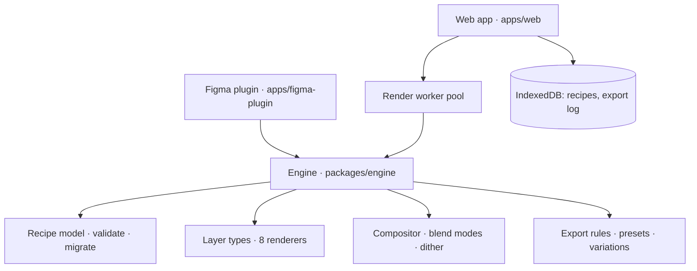

# Material Lab — Architecture

This describes how the code implements the PRD's architecture (§14). The PRD remains the source of truth for
scope and requirements.

## Engine (`packages/engine`)

Platform-neutral TypeScript with no runtime dependencies. Every integration uses it, so a recipe means the same
thing everywhere.

### Recipe model

`Recipe` (`src/types.ts`) follows the PRD's conceptual schema: `schemaVersion`, `recipeId`, `name`, `family`,
`engineVersion`, `seed`, `canvas`, `layers[]`, `exportDefaults`, `metadata`. Each layer has a stable `id`,
`type`, `name`, `enabled`, `opacity`, `blendMode`, an explicit `seedOffset` and `parameters`.

- `validateRecipe` / `parseRecipeJson` (`src/validate.ts`) treat input as untrusted. JSON is size-limited
  (256 KB). Unknown fields are dropped and parameters clamped to their ranges. `__proto__`-style keys are
  ignored and nothing is executed. Structural problems are errors; recoverable ones are warnings shown at
  import.
- Unknown layer types are **kept** (so nothing is lost) but skipped when rendering, with a warning.
- `migrateRecipeData` (`src/migrate.ts`) upgrades older schemas step by step. Schema 1 is the first, so there
  are no migrations yet. The framework and its tests are in place, and the PRD requires a migration test in the
  build pipeline.

### Parameters and layer definitions

Each layer type is a `LayerDefinition` (`src/params.ts`) with typed parameters:

- Parameters are number, color, boolean or select, each with a range, step, unit and default.
- Each parameter belongs to a properties-panel section and can carry help text and visibility conditions.
- Each parameter can have a **variation group** (palette, intensity, scale or structure), used by "Create
  variations".

The UI is generated from these definitions, so adding a parameter needs no UI code.

Layer types (`src/layers/`): `base-color`, `glass`, `grain`, `paper-fiber`, `metallic`, `fabric`, `noise`,
`liquid`. Glass and metallic carry a note that they are stylised effects. Glass is marked
background-dependent: it frosts whatever is beneath it.

### Rendering

`renderRecipe(recipe, { width, height, pixelRatio, transparent, rows? })` renders on the CPU.

- **Why CPU, not WebGL (yet):** the PRD asks for reproducible output within a tolerance and says not to commit
  to a renderer before benchmarking. GPU float precision differs between devices. The CPU path uses only
  `+ − × ÷`, `floor` and `sqrt` per pixel, which IEEE-754 specifies exactly, plus integer hashing (`Math.imul`).
  Trigonometry runs once per layer and is rounded. Output is therefore byte-identical in every browser, worker
  and Node. A GPU path can be added later as an accelerator, if it can be tested against the golden images.
- **Logical pixels.** Texture features are sized in px of the recipe canvas. `pixelRatio` maps those to device
  pixels: below 1 for previews, 2–4 for exports. A 2× export looks the same as 1×, but sharper. Exporting at a
  different size shows more or less of the texture rather than stretching it.
- **Bands and partition independence.** The image is composited in bands of rows (premultiplied float), then
  dithered to 8 bits with a seeded per-pixel offset to avoid banding. Every layer is a pure function of pixel
  position, except glass, which blurs the layers beneath it. Glass blurs with **exact integer** box-blur sums.
  Its refraction field sits on a grid aligned to absolute pixels. As a result, any split of the image into
  bands or row chunks produces identical bytes. Tests check this for every layer type.
- **Glass context rows.** Glass needs rows above and below its band. `compositeRange` renders the layers
  beneath a glass layer over a widened row range. Alternatively, `renderComposite` + `RenderOptions.below`
  supplies them precomputed (see the worker pool).

### Determinism contract

Same recipe + seed + engine version + output settings ⇒ same pixels. If a change alters output:

1. bump `ENGINE_VERSION` (`src/version.ts`);
2. run `npm run golden:update` and review the contact sheets;
3. older recipes keep their recorded `engineVersion`, and importing one made with a different major version shows a
   warning.

`test/golden.test.ts` hashes every preset render.

### Presets, variations, export rules

- `PRESETS` (`src/presets.ts`): 21 starter recipes, 2–3 per family. Each is built from the same schema users
  edit. `instantiatePreset` returns a copy, so the canonical preset never changes.
- `generateVariations` changes only parameters in the chosen dimensions (and optionally only selected layers).
  It records every change and is deterministic for a given variation seed. `withNewSeed` ("New variation")
  changes only the seed.
- `validateExportSettings` (`src/export.ts`) enforces the following:
  - Limits are 8192 px per side and 36 MP of output.
  - Renderer memory is estimated before rendering.
  - JPEG never keeps alpha, and transparency is only offered when the composition has transparent areas.
  - It recommends a supported size when the request is too large.
  - It suggests a file name and estimates the file size.

## Web app (`apps/web`)

React + TypeScript + Vite. No router or state libraries: a tiny hash router (`src/lib/router.ts`) and React
state.

| Area | Where |
| --- | --- |
| Screens (S01–S16 of the user flows) | `src/screens/` — Welcome, Explore, editor, My Recipes, Exports, Settings, import dialog |
| Editor state, undo/redo | `src/editor/state.ts` (reducer with history; slider drags coalesce into one step), `src/editor/ops.ts` (pure recipe edits) |
| Open/save flows, unsaved-changes guard, draft recovery | `src/AppContext.tsx`, `src/lib/draft.ts` |
| Rendering | `src/render/pool.ts` (worker pool), `src/render/preview.ts` (progressive preview scheduler), `src/render/export.ts`, `src/render/thumbnails.ts` |
| Storage | `src/lib/db.ts` (IndexedDB with in-memory fallback), `src/lib/library.ts`, `src/lib/exports-log.ts`, `src/lib/settings.ts` (localStorage) |
| Analytics | `src/lib/analytics.ts` — event taxonomy from the PRD; events stay on the device |

### Worker pool

`RenderPool` runs `navigator.hardwareConcurrency − 1` module workers (at most 8). A frame is split into row
chunks with priorities: interactive preview, then export, then background thumbnails.

- Exports use memory-bounded chunks; this also drives the progress bar. Cancel terminates the workers running
  that export.
- **Two-phase glass.** When a frame has a glass layer, the layers beneath it are rendered once, split across
  workers (`renderComposite`). Each chunk then receives exactly the rows it needs. Without this, every chunk
  would re-render the layers beneath for its context rows. The output is identical either way.

### Preview

`PreviewScheduler` keeps at most one preview render in flight, so rapid edits coalesce.

- Large previews show a fast draft (~90k px) before full preview quality. The budget is set by preview quality:
  0.35, 1 or 2.4 MP.
- A frame is only displayed if it is newer than the one on screen.
- A failed render keeps the last good frame and offers Retry, or a lower preview quality.

Measured in this repository's 4-core CI-class container (3 workers, standard quality, ~480k-px preview): the
preview settles 0.2–0.4 s after a burst of edits for most presets, and ~0.6 s for glass over liquid. The PRD's
target is p95 < 250 ms "on reference hardware". That hardware matrix still needs to be defined (PRD §16) and
measured on typical 8+ core desktops.

### Storage and privacy

- Recipes and the export log (metadata plus a recipe snapshot, never images) live in IndexedDB.
- If IndexedDB is unavailable, data is kept in memory for the session, and Settings says so.
- Preferences and a crash-recovery draft live in localStorage.
- Analytics events carry only coarse, non-identifying properties and are not transmitted
  (`setAnalyticsTransport` is the hook for a future, consented transport).

## Figma plugin (`apps/figma-plugin`)

See its [README](../apps/figma-plugin/README.md).

- The UI iframe renders with the engine and sends PNG bytes. The main thread calls `figma.createImage` and
  inserts a new image-filled rectangle, or fills selected layers.
- It stores a recipe reference in plugin data and enforces Figma's documented 4096 px limit.

## Adding a layer type

1. Add the type to `LAYER_TYPES` (`src/types.ts`) and write a `LayerDefinition` in `src/layers/`. The renderer
   must be a pure function of pixel position (use the seeded noise in `src/noise.ts`, no `Math.random`). If it
   samples the layers beneath, declare a `margin` and keep its arithmetic independent of band boundaries.
2. Register it in `src/layers/index.ts`.
3. Add presets, then run the tests. The partition-independence test covers every registered type automatically.
4. Run `npm run golden:update` and inspect `npx tsx scripts/contact-sheet.ts`.
