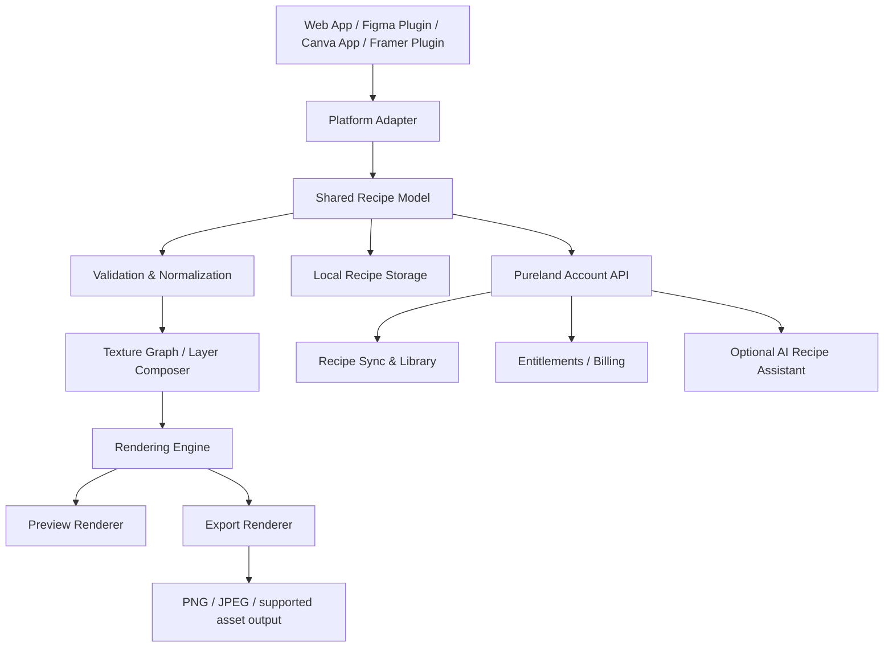

# Material Lab — Texture Generator

**Product Requirements Document (PRD)**  
**Product family:** Pureland · Visual Generation  
**Document version:** 1.0  
**Status:** Draft for product and technical validation  
**Prepared:** 20 October 2026  
**Target platforms:** Web app, Figma plugin, Canva app, Framer plugin/integration  
**Primary audience:** UI/UX designers, visual designers, brand designers, web designers, creative teams

---

## 1. Executive Summary

Material Lab is a cross-platform creative tool for producing repeatable, editable, production-ready textures. It lets users combine procedural texture layers—such as glass, grain, paper, metallic, fabric, noise, and liquid effects—using explicit controls rather than relying on a one-click random generator.

Users can build a texture recipe, adjust its parameters with a live preview, save named recipes, create controlled variations, and export or insert the result into supported design tools. A texture should be reproducible: the same recipe, seed, engine version, and export settings should produce the same output within the defined rendering tolerance.

Material Lab is intended to become one shared creative engine within Pureland. The rendering core and recipe format should be reusable across a web app, Figma plugin, Canva app, and Framer integration, while each platform receives an interface and export flow that fits its native environment.

### Product thesis

Designers do not only need more generated visuals. They need **controlled, repeatable, reusable visual materials** that can be adjusted to fit a brand and delivered reliably into a real design workflow.

### Recommended product strategy

1. Build a shared procedural rendering engine and the standalone web app first.
2. Validate quality and repeatability with texture families that can be compared objectively.
3. Deliver the first platform integration in Figma, where output can be inserted as image-filled shapes or frames.
4. Add Canva and Framer integrations after each platform's import, export, review, and publishing behavior has been technically validated.
5. Keep AI optional. The core product must remain useful without an AI call, unpredictable output, or recurring inference cost.

---

## 2. Problem Statement

Designers frequently need custom surface treatments and visual materials for backgrounds, cards, hero sections, product mockups, campaign graphics, presentations, and brand assets. Existing workflows often require users to:

- Search for stock textures that may not match the intended brand or layout.
- Create effects manually in multiple tools and repeat the work when the design changes.
- Accept random generation without enough control over color, scale, contrast, lighting, or density.
- Rebuild a similar texture for another project or platform because the original settings were not saved.
- Export at an inappropriate size or format, leading to blur, large files, visible tiling, banding, or poor contrast.
- Recreate texture layers in different design environments because recipes and presets do not transfer cleanly.

Material Lab addresses this by treating a texture as a **recipe of layers and parameters**, not as an opaque image created once and discarded.

### User problem statement

“When I need a texture that fits a specific brand and layout, I want precise controls and reusable recipes so I can make, revise, and export the same visual material without rebuilding it from scratch.”

---

## 3. Product Vision and Positioning

### Vision

Make Material Lab the trusted place to create, tune, save, and reuse design textures across the tools designers already use.

### Positioning statement

For designers who need distinctive, production-ready textures, Material Lab is a procedural texture studio that combines layer-level control, reproducible recipes, and multi-platform export. Unlike basic random texture generators, it lets users intentionally create and revise a visual material.

### Core differentiators

1. **Layer-based creation:** Stack and reorder effects instead of selecting a single opaque preset.
2. **Deterministic recipes:** Recreate the same result from saved settings and a seed.
3. **Useful controls:** Provide sensible art-direction controls—not a wall of unexplained shader parameters.
4. **Brand consistency:** Reuse color, contrast, roughness, grain, scale, and lighting settings across projects.
5. **Cross-platform workflow:** Use the same recipe concept across the web app and supported design-tool integrations.
6. **Production-ready export:** Make resolution, dimensions, transparency, tiling, and file-size trade-offs clear.
7. **Optional intelligence:** Use AI only for helpful tasks such as translating natural-language direction into an editable starting recipe; never make AI necessary for basic rendering.

### Brand principles

- Precise, calm, professional, and visually focused.
- Controls should be understandable to a designer, with advanced controls available on demand.
- The interface should make the preview the hero; avoid oversized dashboards and decorative clutter.
- Use neutral UI surfaces and clear semantic status styles. Texture presets, not the product interface, provide most of the color.

---

## 4. Goals, Non-Goals, and Success Criteria

### 4.1 Product goals

- Enable a first-time user to generate and export a good-looking texture in under three minutes.
- Support all seven planned texture families: glass, grain, paper, metallic, fabric, noise, and liquid.
- Let users build textures from reusable layers and edit a layer without restarting the design.
- Produce deterministic output from saved recipe data, seed, engine version, and export settings.
- Support reusable presets, recipe saving, duplication, naming, favorites, and controlled variations.
- Provide a smooth workflow for exporting from the web app and inserting results into supported design tools.
- Keep the core renderer fast enough for interactive preview on typical modern desktop hardware.
- Create reusable technical foundations for future Pureland visual products.

### 4.2 Non-goals for initial release

- Replacing Photoshop, Blender, Substance 3D, or advanced compositing applications.
- Full physically based material authoring or production-ready PBR maps in the MVP.
- A complete 3D scene, geometry, or camera editor.
- Automatically generating entire websites or full brand identities.
- Unlimited cloud rendering or large-scale AI image generation.
- Guaranteed live, bidirectional synchronization of every texture property across every third-party platform.
- A marketplace for user-created recipes in the MVP.
- Mobile-first texture authoring. Mobile may support viewing and basic export later; desktop is the first priority.

### 4.3 Success criteria for the first public release

Targets below are hypotheses and should be recalibrated after the first usability and beta cohort.

| Metric | Initial target | Measurement |
|---|---:|---|
| Time to first successful export | Median under 3 minutes | First-session product analytics |
| Preview responsiveness | 95th percentile under 250 ms for standard preview updates | Client performance instrumentation |
| Export success rate | At least 98% for supported settings | Export events and errors |
| Recipe reproducibility | At least 99% byte- or pixel-equivalent output where rendering environment permits; otherwise visual-difference threshold defined per engine | Automated render tests |
| First-session activation | At least 45% create or modify a texture and export/insert it | Activation funnel |
| Four-week returning-user rate | Establish baseline; initial goal 20%+ for users who save a recipe | Cohort analytics |
| Support burden | Under 5 texture-generation/export incidents per 100 active users per month after stabilization | Support tags |
| User confidence | At least 4/5 average response to “I can recreate this texture later” | In-product survey |

---

## 5. Target Users and Personas

### Persona A — UI/UX Designer

**Needs:** Distinct backgrounds and surface effects for apps, dashboards, cards, empty states, and presentations.  
**Pain:** Stock assets feel generic; manual effects consume time and may not scale across breakpoints.  
**Success:** Generate a subtle texture, tune contrast, and insert it into Figma in a few minutes.

### Persona B — Brand / Visual Designer

**Needs:** Textures that align with a brand's color palette and visual character across social assets, landing pages, and campaigns.  
**Pain:** Variants are difficult to keep consistent when recreated by hand.  
**Success:** Save a recipe and generate controlled campaign variations without losing the visual style.

### Persona C — Framer / Webflow Designer

**Needs:** Lightweight visual treatments and web-compatible assets for website sections and cards.  
**Pain:** Textures can create large assets, hurt loading performance, or fail to reproduce between design and published site.  
**Success:** Export an appropriate image or code-oriented result, inspect file size, and use it in a real website workflow.

### Persona D — Content Creator / Canva User

**Needs:** Textured backgrounds and branded graphics for presentations, thumbnails, social content, and marketing assets.  
**Pain:** General-purpose design apps offer fast templates but limited texture-specific art direction.  
**Success:** Choose a style, make a few understandable adjustments, and add it to a Canva design.

### Persona E — Design Lead / Small Studio

**Needs:** Repeatable visual recipes shared across team projects and campaigns.  
**Pain:** Different designers recreate near-identical visuals with inconsistent settings.  
**Success:** Maintain a shared library of approved recipes and approved variants.

---

## 6. Jobs to Be Done

1. When I need a background for a UI card, I want to generate a subtle grain or paper texture that does not reduce text legibility.
2. When I am designing a premium product or landing page, I want to create glass, metallic, or liquid effects with deliberate lighting and color control.
3. When a client requests a variation, I want to change only the color or intensity without losing the rest of the texture.
4. When I move between projects, I want to reuse the same recipe and reproduce the output.
5. When a team approves a texture, I want to share a saved recipe instead of sending only a flattened image.
6. When I export a texture, I want to know its dimensions, transparency, tiling behavior, format, and expected file size.
7. When I work in a supported design tool, I want to insert the generated result without manually downloading, locating, and re-uploading it.

---

## 7. Platform Strategy and Release Scope

### Platform roles

| Platform | Primary purpose | Initial capability | Release recommendation |
|---|---|---|---|
| Web app | Full authoring studio and canonical recipe editor | Full editor, layer stack, preset browser, save/share, export | MVP foundation |
| Figma plugin | Create and insert textures in the active design file | Browse presets, edit basic parameters, export PNG and insert as image-filled shape/frame | First integration after engine validation |
| Canva app | Generate assets inside an existing Canva workflow | Browse, customize, add PNG/SVG assets to a design where supported | Phase 2; validate app permissions and review requirements |
| Framer plugin/integration | Add texture assets or supported visual effects to a Framer project | Export/import asset workflow first; native/code effect integration only after a spike | Phase 3 |

### Platform constraints to validate

- **Figma:** The documented `figma.createImage()` API accepts PNG, JPEG, or GIF image bytes. The official API documentation specifies a 4096-pixel ceiling for width and height. Insertion should be designed around supported image fills and shapes; do not promise arbitrary editable shader graphs inside the Figma document. [Figma `createImage`](https://developers.figma.com/docs/plugins/api/properties/figma-createimage/) · [Figma Image object](https://developers.figma.com/docs/plugins/api/Image/)
- **Canva:** Canva apps can add image assets such as PNG or SVG to a user's media library/design using the Canva Developers SDK. The production implementation must handle required permissions, public asset URL requirements, user storage limits, and review requirements. [Creating images](https://www.canva.dev/docs/apps/creating-images/)
- **Framer:** Framer provides an official plugin API and development workflow. The precise supported way to add or configure texture output in a user's project must be validated in a prototype. Start with a robust asset workflow and add native/code-based effects only where the supported API allows it. [Framer plugin quick start](https://www.framer.com/developers/plugins-quick-start/) · [Framer developer reference](https://www.framer.com/developers/reference)
- **Cross-platform parity:** A shared recipe may be portable while the resulting integration is not identical on every platform. Export types, permissions, editable-layer support, image handling, and platform APIs vary. UI and product copy must be clear about platform-specific limitations.

---

## 8. Texture Families and Requirements

Material Lab includes seven planned texture families. The MVP should launch with a carefully tested subset of each family's most useful parameters, then expand into advanced controls after quality validation.

### 8.1 Glass

**Purpose:** Frosted glass, translucent haze, soft blur, glass grain, and reflective or iridescent surfaces.

Controls:
- Frosting / blur intensity.
- Transparency / opacity where applicable.
- Grain amount and grain scale.
- Edge highlight intensity and width.
- Refraction distortion amount for raster effects.
- Tint color and tint strength.
- Reflection/highlight direction.
- Base color and contrast.

Acceptance considerations:
- Exported result must clearly distinguish frosted glass from a flat translucent fill.
- Controls must warn when an effect depends on the chosen background and may look different over another background.
- No claim of physically accurate refraction in the MVP; label the mode as a stylized visual effect.

### 8.2 Grain

**Purpose:** Add film grain, subtle analog texture, and organic surface variation.

Controls:
- Grain amount.
- Grain size.
- Monochrome vs colored grain.
- Distribution / clumping.
- Contrast.
- Blend mode where supported by the renderer.
- Seed.

Acceptance considerations:
- Noise distribution must be predictable and avoid obvious repeating artifacts at common canvas sizes.
- Provide a low-intensity preset appropriate for UI backgrounds.
- Ensure controls work on dark and light color fields.

### 8.3 Paper

**Purpose:** Paper fiber, recycled paper, rough stock, soft pulp, and print-inspired surfaces.

Controls:
- Paper tone.
- Fiber density and length.
- Fiber directionality.
- Speckle amount and size.
- Wrinkle / fold intensity (advanced).
- Surface roughness / unevenness.
- Aging or warmth.

Acceptance considerations:
- Offer both subtle modern paper and more expressive vintage options.
- Avoid generating only generic noise with a paper tint; fiber and speckle structure must be visually recognizable.
- Seamless mode must be tested separately from non-seamless paper output.

### 8.4 Metallic

**Purpose:** Brushed metal, chrome-inspired gradients, anodized color, gold/silver surfaces, and stylized reflective finishes.

Controls:
- Metal type preset.
- Highlight direction and width.
- Brushed-line direction and scale.
- Roughness / softness.
- Contrast and highlight roll-off.
- Tint / alloy color.
- Reflection band pattern.
- Scratches / microtexture level.

Acceptance considerations:
- Be clear that the MVP renders a stylized 2D effect, not a true environment-mapped 3D material.
- Avoid harsh banding; test gradients at large dimensions and compressed formats.
- A color change must not destroy the metallic appearance.

### 8.5 Fabric

**Purpose:** Linen, canvas, woven cloth, knit-inspired surfaces, and fine textile grain.

Controls:
- Weave type.
- Warp/weft scale.
- Thread density.
- Fiber variation.
- Direction and rotation.
- Color variation.
- Roughness and contrast.
- Seamless tiling.

Acceptance considerations:
- Warp and weft directions should remain coherent under rotation.
- Small-repeat tiles must not show obvious discontinuities when repeated.
- Fabric types must differ structurally, not merely by hue.

### 8.6 Noise

**Purpose:** Fine-grain overlays, dithering-inspired textures, subtle noise, and procedural fields.

Controls:
- Noise algorithm/type (MVP-supported set only).
- Scale / frequency.
- Amplitude.
- Monochrome vs colored noise.
- Contrast / distribution.
- Smoothness / octave count (advanced).
- Seed.
- Optional masking or alpha output.

Acceptance considerations:
- A preview-quality mode may render faster, but full-resolution export must use the selected export settings.
- Avoid visible periodic patterns unless the user deliberately chooses a tiled style.
- Different noise choices must have recognizable visual differences.

### 8.7 Liquid

**Purpose:** Stylized liquid, fluid distortion, marbling, flowing contours, and organic swirls.

Controls:
- Flow direction.
- Distortion amount.
- Swirl scale.
- Smoothness.
- Color stops / palette.
- Layer blend / opacity.
- Edge detail.
- Seed.

Acceptance considerations:
- Saved recipes reproduce the same visual structure.
- Provide a low-distortion option for backgrounds that need readable content over them.
- Animated liquid is not a P0 requirement; consider it a future motion-family integration.

---

## 9. Scope and Prioritization

### P0 — MVP must-have

- Web-based texture editor with responsive desktop layout.
- Seven texture-family categories in the preset browser, with at least two high-quality starter presets per family if quality gates are met. If a family cannot meet quality, mark it beta rather than shipping placeholder output.
- Layer stack: add, remove, rename, reorder, duplicate, enable/disable, and adjust opacity.
- Family-specific parameters with sensible defaults and reset behavior.
- Live preview with preview-resolution mode.
- Seeded deterministic generation and explicit “New variation” control.
- Undo/redo for parameter and layer changes within the current session.
- Recipe save, rename, duplicate, delete, favorite, and reopen.
- Export: PNG and JPEG; transparency available for PNG where the selected effect supports it.
- Export controls for dimensions, scale, background/alpha, and filename.
- Export metadata: recipe name, dimensions, format, file size, seed, and engine version when available.
- Local export without an account.
- Optional account sign-in to sync recipes across supported devices/platforms.
- Keyboard navigation for major controls and accessible labels.
- Error and progress states for render, save, sync, and export.
- Basic instrumentation to measure generation, recipe saving, and export flows.

### P1 — Near-term follow-up

- Figma plugin with insert-from-library and insert-current-texture flows.
- Recipe links that can open a read-only preview and optionally duplicate to a user's library.
- Seamless tiling preview and tile export.
- Controlled variation grid (e.g., 4/8/12 candidates based on performance).
- Batch export of selected variations.
- Shared team folders and approved recipes.
- Import/export recipe JSON.
- Recent history with rollback to a previous saved version.
- Optional AI-assisted prompt-to-recipe that maps a short description into editable parameters.
- Framer integration prototype.
- Basic Canva app integration after SDK and review feasibility are confirmed.

### P2 — Later / validate demand first

- Animated texture export (GIF/video or platform-supported motion implementation).
- Advanced masks and blend modes.
- Multi-map material channels (normal, roughness, height, displacement) for specialist use.
- Plugin-to-plugin recipe transfer across the Pureland ecosystem.
- Team roles, comments, approval workflow, and audit history.
- Recipe marketplace or public community library.
- API access for teams.
- Advanced node-based graph editor.
- Cloud rendering for particularly expensive/high-resolution recipes.

---

## 10. Core User Flows

### Flow A — First-time user creates a texture

1. User opens Material Lab.
2. Landing view offers “Start from a preset” and “Start blank.”
3. User chooses a family (e.g. Paper) and previews starter presets.
4. User opens a preset in the editor.
5. The editor displays canvas preview, layer stack, selected-layer controls, and export action.
6. User adjusts tint, grain, and fiber scale; preview updates.
7. User optionally changes the seed to generate a new variation.
8. User exports PNG/JPEG and selects dimensions.
9. App validates settings, renders full resolution, and displays success with file metadata.
10. User can save the recipe, continue editing, or create another variation.

**Success state:** A valid asset is downloaded or inserted; the user understands how to recreate it.

### Flow B — User builds a layered texture

1. User starts blank or opens an existing recipe.
2. User adds a base layer.
3. User selects a texture type and configures its parameters.
4. User adds another layer (e.g. Grain on top of Paper).
5. User adjusts order, opacity, and supported blend mode.
6. Preview renders incrementally.
7. User saves as a named recipe.
8. System persists a versioned recipe definition and seed.

### Flow C — User creates controlled variations

1. User selects a saved recipe.
2. User clicks “Create variations.”
3. User selects which properties can vary: palette, scale, intensity, seed, or selected layer parameters.
4. User chooses number of options within the supported limit.
5. System generates the variations and labels each with its changed parameters.
6. User selects one candidate, compares it with the original, and saves it as a new recipe or version.

### Flow D — User inserts texture into Figma

1. User opens the Material Lab Figma plugin in a file.
2. Plugin offers “Use preset,” “Open saved recipe,” or “Generate in plugin.”
3. User previews the texture and chooses output dimensions/scale.
4. Plugin renders or retrieves a supported PNG/JPEG/GIF asset.
5. User chooses “Insert to canvas.”
6. Plugin creates a shape/frame with an image fill, or inserts an image-backed shape using the supported Figma API.
7. Plugin optionally adds a component description or plugin data containing recipe reference and version, where supported and appropriate.
8. User receives confirmation and can continue editing in Figma.

**Important:** The recipe remains editable in Material Lab; a rendered image inside Figma does not imply native editability of every shader parameter. Plugin UI must clearly differentiate “reopen recipe” from editing pixels in Figma.

### Flow E — User inserts texture into Canva

1. User opens the Material Lab app inside Canva.
2. User chooses a preset or saved recipe.
3. User adjusts controls supported by the app.
4. App renders the texture and uploads it through the supported Canva asset workflow.
5. User adds the image asset to the design.
6. App reports success or explains any permission, network, or storage issue.

### Flow F — User uses texture in Framer

1. User opens the Material Lab plugin/integration in Framer.
2. User selects or creates a texture.
3. User previews the texture and chooses a supported output mode.
4. MVP workflow imports or adds an asset to the project using the validated Framer API path.
5. User checks the result in preview/publish context.
6. Later versions may support code-oriented effects when the platform API and implementation permit it.

### Flow G — Cross-platform recipe reuse

1. User signs in to Pureland.
2. User saves recipe to a personal or team library.
3. A supported platform integration requests available recipes.
4. Service checks account access and recipe compatibility.
5. Integration loads supported parameters and presents any incompatible properties as warnings.
6. User previews the resulting texture and exports/inserts it.

---

## 11. Information Architecture and Key Screens

### Web app navigation

- **Create** — texture editor.
- **Explore** — presets grouped by family and use case.
- **My Recipes** — personal saved recipes, favorites, recent items, folders.
- **Shared** — shared links and team library, when enabled.
- **Exports** — recent export details and retryable failures where retained.
- **Settings** — profile, plan, default export settings, theme, privacy, connected platforms.

### Editor layout

**Header**
- Product logo and workspace switcher.
- Recipe name and save status.
- Undo/redo.
- Share and export actions.

**Left rail: Layers**
- Layer list with type icon and name.
- Visibility toggle.
- Drag/reorder affordance.
- Add layer button.
- Duplicate/delete actions.

**Center: Preview canvas**
- High-quality preview.
- Zoom-to-fit and zoom controls.
- Background checkerboard for transparency.
- Optional tiling preview.
- Toggle for preview background color.

**Right panel: Properties**
- Controls for selected texture layer.
- Sections: Appearance, Structure, Color, Lighting, Output/Advanced where relevant.
- Numeric inputs and sliders for values requiring precision.
- Reset control per property and layer.

**Bottom or collapsible panel: Variations and history**
- Variation grid.
- Previous/next saved version.
- Seed field and “New variation” button.

### Main empty states

- No recipe: show presets and create-blank option.
- No saved recipes: explain local export works without sign-in; offer sign-in for sync.
- No recent exports: show first export CTA.
- Unsupported platform feature: show a clear compatibility note and offer supported raster export.

---

## 12. Functional Requirements

Priority legend: **P0 = MVP**, **P1 = next release**, **P2 = later**.

### 12.1 Preset browser

- **FR-001 (P0):** Display texture presets grouped by family: Glass, Grain, Paper, Metallic, Fabric, Noise, Liquid.
- **FR-002 (P0):** Each preset shows a preview, name, family, and short purpose description.
- **FR-003 (P0):** Users can search presets by name, family, tag, or use case.
- **FR-004 (P1):** Allow filtering by style (subtle, tactile, glossy, organic, industrial), palette, and seamless support.
- **FR-005 (P0):** Selecting a preset opens the editable recipe, not just a flattened preview.
- **FR-006 (P0):** Provide clear labels for beta presets or unsupported export types.

### 12.2 Layer composition

- **FR-010 (P0):** Add a texture layer from supported types.
- **FR-011 (P0):** Remove, duplicate, rename, reorder, enable, and disable a layer.
- **FR-012 (P0):** Adjust layer opacity.
- **FR-013 (P0):** Selecting a layer reveals only the relevant controls.
- **FR-014 (P1):** Provide supported blend modes with consistent behavior in preview and export.
- **FR-015 (P0):** Allow a single-layer recipe; layer count must be limited by performance and clearly communicated.
- **FR-016 (P0):** Warn before destructive operations when unsaved work would be lost.

### 12.3 Texture controls

- **FR-020 (P0):** Controls update the preview without requiring a full page reload.
- **FR-021 (P0):** Every parameter has a valid range, default value, display label, and accessible control.
- **FR-022 (P0):** Numeric values can be entered directly where precision matters.
- **FR-023 (P0):** Reset per property and reset layer actions are available.
- **FR-024 (P0):** Seeded random features use an explicit seed.
- **FR-025 (P0):** “New variation” changes seed or selected parameters according to a visible rule; it must not silently modify unrelated properties.
- **FR-026 (P1):** Provide global palette mapping to recolor compatible layers.
- **FR-027 (P1):** Support color sampling/input from HEX and RGB; HSL may be added if needed.
- **FR-028 (P1):** Advanced options are collapsed by default for beginner usability.

### 12.4 Preview and rendering

- **FR-030 (P0):** The editor has a live preview that reflects the current recipe.
- **FR-031 (P0):** Use a lower-resolution preview when full-resolution rendering would reduce responsiveness.
- **FR-032 (P0):** Clearly distinguish preview quality from export quality.
- **FR-033 (P0):** Prevent stale asynchronous renders from replacing the newest requested state.
- **FR-034 (P0):** Show progress for operations that exceed the defined short-operation threshold.
- **FR-035 (P0):** On render failure, preserve the last successful preview and show a recoverable error.
- **FR-036 (P1):** Provide checkerboard transparency preview and tiling preview.
- **FR-037 (P1):** Show before/after comparison for substantial recipe edits.

### 12.5 Recipe management

- **FR-040 (P0):** Save, rename, duplicate, delete, favorite, and reopen recipes.
- **FR-041 (P0):** Each recipe stores the layer stack, parameters, seed, schema version, rendering engine version, and relevant default export settings.
- **FR-042 (P0):** Local users can export without creating an account.
- **FR-043 (P0):** Sign-in enables server-side recipe sync if that feature is enabled for the release.
- **FR-044 (P1):** Provide recipe JSON import/export with schema validation and safe limits.
- **FR-045 (P1):** Support recipe version history and restore.
- **FR-046 (P1):** Share a read-only recipe link; duplicate-to-library requires clear user action.
- **FR-047 (P2):** Support team folders, roles, and approved recipes.

### 12.6 Export

- **FR-050 (P0):** Export PNG and JPEG.
- **FR-051 (P0):** PNG transparency must be preserved when enabled and supported by the composition.
- **FR-052 (P0):** Offer export dimensions using presets plus custom width/height within product and platform limits.
- **FR-053 (P0):** Validate output dimensions and estimate memory needs before a large render.
- **FR-054 (P0):** Produce a meaningful filename based on recipe and dimensions; allow user override.
- **FR-055 (P0):** Show output format, dimensions, file size, and success/failure status.
- **FR-056 (P0):** Handle cancellation and retryable errors where possible.
- **FR-057 (P1):** Support seamless tile export, with an explicit seamless-preview mode.
- **FR-058 (P1):** Batch export selected variations.
- **FR-059 (P1):** Add SVG export only for layers/rendering modes that can be faithfully represented as vector; do not silently rasterize and label the result as fully editable SVG.
- **FR-060 (P2):** Add animated export formats only after timing, size, and platform compatibility are validated.

### 12.7 Platform integrations

- **FR-070 (P0):** Web app works as a standalone product with no design-platform account connection.
- **FR-071 (P1):** Figma plugin inserts a supported raster result into the active file and handles selection/context safely.
- **FR-072 (P1):** Figma plugin reports whether the inserted object is a raster image-backed shape and links to recipe reopening where possible.
- **FR-073 (P1):** Canva app adds supported PNG/SVG output into the user's design through the approved SDK flow.
- **FR-074 (P1/P2):** Framer plugin supports the integration pattern confirmed by a technical spike; initial scope may use raster asset insertion/import.
- **FR-075 (P0):** Every integration checks platform/API availability and gracefully handles unavailable features.
- **FR-076 (P0):** Platform integrations must not promise exact visual parity if the destination cannot represent a layer effect.

### 12.8 Optional AI assistant

- **FR-080 (P2):** Let the user enter a short direction such as “warm recycled paper with subtle dark fibers.”
- **FR-081 (P2):** Convert the direction into an editable, validated recipe; do not return only an opaque image.
- **FR-082 (P2):** Show the parameters selected by the assistant and let the user modify them before rendering.
- **FR-083 (P2):** Never send recipe content or uploaded assets to a third-party AI service without disclosure and appropriate user control.
- **FR-084 (P2):** If AI is unavailable or rejected, the user can use the standard editor normally.

---

## 13. Recipe Data Model

The recipe should be a versioned, platform-neutral JSON structure. This is a conceptual schema, not final generated TypeScript.

```json
{
  "schemaVersion": 1,
  "recipeId": "recipe_local_01",
  "name": "Warm recycled paper",
  "family": "paper",
  "engineVersion": "1.0.0",
  "seed": 482913,
  "canvas": {
    "width": 1600,
    "height": 1000,
    "colorSpace": "sRGB",
    "transparentBackground": false
  },
  "layers": [
    {
      "id": "layer_base",
      "type": "base-color",
      "name": "Warm base",
      "enabled": true,
      "opacity": 1,
      "parameters": {
        "color": "#E8D9BD"
      }
    },
    {
      "id": "layer_paper",
      "type": "paper-fiber",
      "name": "Paper fibers",
      "enabled": true,
      "opacity": 0.65,
      "seedOffset": 15,
      "parameters": {
        "fiberDensity": 0.42,
        "fiberScale": 0.55,
        "speckleAmount": 0.18,
        "warmth": 0.7,
        "roughness": 0.38
      }
    },
    {
      "id": "layer_grain",
      "type": "grain",
      "name": "Fine grain",
      "enabled": true,
      "opacity": 0.2,
      "seedOffset": 31,
      "parameters": {
        "amount": 0.12,
        "scale": 0.34,
        "monochrome": true
      }
    }
  ],
  "exportDefaults": {
    "format": "png",
    "width": 1600,
    "height": 1000,
    "seamless": false
  },
  "metadata": {
    "createdAt": "2026-10-20T00:00:00.000Z",
    "updatedAt": "2026-10-20T00:00:00.000Z"
  }
}
```

### Recipe model requirements

- Every layer has a stable ID, type, name, enabled state, opacity, and validated parameters.
- The seed and per-layer seed offsets must be explicit for all randomized outputs.
- Schema migrations must handle older recipes when parameters or rendering behavior change.
- Unsupported layer types must not crash the editor; show an unsupported-layer warning and allow removal or export where possible.
- A shared recipe must record engine version and schema version to support reproducibility and compatibility.
- User-supplied JSON must be size-limited and validated. It must never execute arbitrary code or expressions.

---

## 14. Technical Architecture

### Recommended conceptual architecture



### 14.1 Rendering engine

**Recommendation:** Begin with a client-side procedural renderer using Canvas 2D and/or WebGL, chosen through performance and output-quality prototypes. Use a shared, typed recipe representation and isolate platform-specific integrations from the rendering core.

A hybrid renderer may be appropriate:
- Canvas 2D for compositing and effects that do not require GPU shaders.
- WebGL shaders for noise fields, distortion, stylized reflection bands, and other effects that benefit from GPU execution.
- Worker/OffscreenCanvas where supported and useful to keep the interface responsive.
- A fallback path for unsupported GPU features or device contexts.

Do not commit to one renderer until the team has benchmarked the required texture families, browsers, and exports.

### 14.2 Determinism

Deterministic output requires more than recording one random seed. Version the algorithm and preserve the parameter mapping. For a fixed recipe, engine version, dimensions, color space, and export format, output should be reproducible within the specified tolerance. If a rendering change intentionally alters output, bump the engine version and include a migration/re-render policy.

### 14.3 Render pipeline

1. Validate recipe and output settings.
2. Normalize parameters to valid ranges.
3. Generate an immutable render request ID.
4. Render preview at a fit-for-interaction resolution.
5. Discard stale responses if the user has changed settings since the request began.
6. Render final export at the requested output dimensions.
7. Encode in selected format.
8. Calculate output metadata and surface any warnings.
9. Present export success or a recoverable error.

### 14.4 Backend services

The core editor and local export should work without backend access. The backend is responsible for features that need an account or shared state:
- Authentication and profile.
- Recipe synchronization.
- Shared/team library and share links.
- Product entitlements and subscription status.
- Versioned preset catalogue delivery.
- Optional AI prompt-to-recipe service.
- Operational metrics and error aggregation, subject to privacy policy.

Avoid sending raw design content or exported images to the backend when local processing is sufficient.

### 14.5 Suggested stack (validate with team constraints)

- Frontend: React + TypeScript.
- UI: shared design system with platform adapters; avoid forcing every integration into an identical layout.
- Rendering: TypeScript recipe model plus Canvas/WebGL engine.
- Local persistence: IndexedDB or equivalent browser storage for local recipes and recent items.
- Backend: a small authenticated API and relational database for accounts, cloud recipes, sharing, entitlements, and team data.
- Asset storage: object storage only where needed for shared assets or persisted previews; define lifecycle and deletion policy.
- Testing: unit tests for recipe validation and seeded algorithms; golden-image comparisons for renderer changes; platform integration tests.

This stack is a recommendation, not a requirement. The core architectural requirement is the portable recipe model and rendering engine.

---

## 15. Conceptual API Design

Endpoint names are proposals and may change with the chosen backend.

| Method | Endpoint | Purpose | Phase |
|---|---|---|---|
| GET | `/v1/presets` | List preset metadata and compatibility | MVP |
| GET | `/v1/presets/{presetId}` | Retrieve validated recipe template | MVP |
| GET | `/v1/recipes` | List current user's synced recipes | Account sync |
| POST | `/v1/recipes` | Create/sync recipe | Account sync |
| GET | `/v1/recipes/{recipeId}` | Retrieve recipe | Account sync |
| PATCH | `/v1/recipes/{recipeId}` | Update recipe | Account sync |
| DELETE | `/v1/recipes/{recipeId}` | Delete recipe | Account sync |
| POST | `/v1/recipes/{recipeId}/share` | Create share link with selected access mode | P1 |
| DELETE | `/v1/shares/{shareId}` | Revoke share link | P1 |
| GET | `/v1/entitlements` | Retrieve account/platform entitlements | Account features |
| POST | `/v1/ai/recipe-suggestion` | Optional text-to-recipe mapping | P2 |

### API behavior requirements

- Validate ownership and access on every recipe request.
- Enforce payload size, parameter ranges, and request rate limits.
- Use optimistic concurrency or version numbers to avoid overwriting newer recipes.
- Do not expose private recipe IDs or data through guessable public endpoints without access checks.
- Share links must support revocation and clearly defined read/duplicate permissions.
- API errors should return stable error codes and user-safe messages.

---

## 16. Performance and Quality Requirements

### Performance

- Initial web app interactive target: under 3 seconds on a typical modern desktop connection, excluding unusually slow networks and third-party platform startup.
- Standard preview updates: 95th percentile under 250 ms for common low/medium-complexity recipes on reference hardware.
- Final export: progress indicator appears for operations lasting more than 500 ms; long exports remain cancelable where technically possible.
- Do not block the main UI thread with large synchronous renders if a worker or GPU path is feasible.
- Limit simultaneous high-resolution variation renders according to device capability.
- Detect out-of-memory or context-loss failures and suggest lower dimensions/complexity.

### Visual quality

- Avoid obvious seams in seamless mode at all tile edges.
- Avoid banding in metallic, gradient, and glass-like effects at standard export resolutions.
- Keep grain and noise distribution visually stable between preview and export.
- Match preview to final output, excluding documented differences due to resolution, color management, or platform rendering.
- Provide subtle default presets suitable for UI backgrounds, as well as expressive presets for marketing visuals.
- Include a test grid for light backgrounds, dark backgrounds, high-contrast palettes, and transparent exports.

### Browser and platform coverage

- Define a supported desktop browser matrix after a technical spike.
- Test GPU-disabled or unsupported contexts and provide a fallback renderer where reasonable.
- Test the currently supported versions of Figma, Canva, and Framer environments before each integration release.
- Treat platform API changes as potential release blockers; monitor official documentation and update adapters independently of the rendering core.

---

## 17. Accessibility and Usability

- All controls have accessible names, keyboard focus states, and meaningful labels.
- Do not rely on color alone to communicate layer states, errors, or selection.
- Include direct numeric entry for important values such as scale, opacity, and dimensions.
- Support keyboard use for add/remove layer, reorder, undo/redo, and export where feasible.
- Respect reduced-motion preferences for any future animated previews.
- Do not automatically animate the main preview in a way that causes distraction or motion discomfort.
- Ensure text in the UI meets the team's chosen accessibility contrast standard.
- Use tooltips for technical values such as seed offsets or octave counts without making them mandatory for ordinary use.
- Keep the default interface approachable; reveal advanced controls progressively.

---

## 18. Privacy, Security, and Data Handling

### MVP principles

- Local texture generation and local export should not require uploading user designs to Pureland servers.
- A user must opt into account syncing; explain what recipe metadata is synchronized.
- Avoid collecting exported images unless necessary for an explicitly selected feature.
- Clearly disclose any third-party service that processes prompts or assets.
- Do not use user recipes or uploads for model training without explicit, separate consent.
- Provide a way to delete cloud recipes and account data subject to documented legal/operational requirements.
- Protect recipe and team APIs with authentication, authorization, and rate limiting.
- Sanitize imported recipe JSON and ignore unexpected executable or unknown fields.
- Keep platform tokens and secrets out of client bundles. Use official authentication/permission flows for integrations.
- Define telemetry events and retention duration in the privacy documentation.

### Security scenarios to test

- A user cannot read or modify another user's private recipes by changing an ID.
- A shared link can be revoked and cannot be used to modify the original recipe unless edit access is explicitly granted.
- Malformed recipe data does not crash the application or execute code.
- Export and recipe sync errors do not leak access tokens or sensitive data into logs.
- Uploaded preview assets are access-controlled and have a deletion lifecycle.

---

## 19. Analytics and Product Metrics

### Event taxonomy

- `app_opened`
- `preset_gallery_viewed`
- `preset_selected`
- `recipe_created`
- `layer_added`
- `layer_removed`
- `parameter_changed`
- `variation_generated`
- `recipe_saved`
- `recipe_reopened`
- `recipe_export_started`
- `recipe_export_succeeded`
- `recipe_export_failed`
- `platform_insert_started`
- `platform_insert_succeeded`
- `platform_insert_failed`
- `account_sync_enabled`
- `share_created`
- `subscription_viewed`
- `subscription_started`
- `subscription_cancelled`

### Metric definitions

- **Activation:** percentage of new users who change or select a recipe and successfully export/insert within their first session.
- **Recipe reuse rate:** percentage of active users who reopen a previously saved recipe within 28 days.
- **Export completion:** successful exports divided by export attempts, by format and platform.
- **Preset-to-edit rate:** share of preset opens followed by at least one meaningful parameter change.
- **Cross-platform adoption:** share of signed-in users using Material Lab on at least two supported platforms.
- **Paid conversion:** eligible free users who start a paid plan over a defined attribution window.
- **Retention:** returning active users at D7, D28, and later cohort intervals.
- **Performance:** preview latency, export duration, crashes, renderer fallback rate, and GPU context-loss incidence.

### Privacy-aware analytics

Do not send raw recipe parameter values, exported content, or names containing user/client identifiers to analytics unless specifically justified and disclosed. Prefer aggregated events and coarse feature flags.

---

## 20. Monetization Hypothesis

Material Lab should fit into Pureland's eventual cross-platform subscription, but the product must prove standalone value first.

### Potential tiers (validate with pricing research)

**Free**
- Access to a starter preset set.
- Basic layer editing.
- Standard-resolution PNG/JPEG export.
- Local recipes.
- Small daily/monthly limit only if needed to control a meaningful service cost; avoid artificial limits on inexpensive local actions.

**Creator**
- Full texture families and parameter controls.
- Higher export dimensions.
- More recipes and variation batches.
- Recipe sync across supported platforms.
- Premium preset packs.
- Cross-platform integrations where available.

**Studio / Team**
- Shared libraries and approved recipes.
- Team folders and access controls.
- Shared brand palettes.
- Version history and team usage insights.
- Centralized billing where appropriate.

### Monetization principles

- Do not charge per click for a local renderer unless a meaningful cost exists.
- A free plan should let users assess texture quality before paying.
- Show platform compatibility and plan entitlements clearly.
- Do not imply that a subscription includes unavailable or unreleased integrations.
- Measure retention and multi-tool usage before assuming a universal Pureland subscription increases willingness to pay.

---

## 21. Competitive Landscape and Differentiation Hypotheses

This is a product-planning comparison, not a complete competitor audit. Competitor features and prices change and should be re-verified before launch.

| Alternative | What users may value | Material Lab response |
|---|---|---|
| Built-in design-tool effects | No context switching; native workflow | Better texture-specific controls, recipes, and reproducibility |
| Standalone online texture generators | Quick, accessible output | Persistent layer stack, saved recipes, and export consistency |
| Stock texture libraries | Very high quality, fast selection | Customizable, brand-matched variations and deterministic settings |
| Raster editors (e.g. Photoshop) | Comprehensive editing | Faster focused workflow for common designer texture jobs |
| Shader / generative-art tools | Fine control and procedural flexibility | Designer-friendly controls and direct design-tool integration |
| AI image generators | Fast novel visuals and broad ideation | Editable recipe controls, precise repeatability, and no required prompt loop |

### Differentiation must be proven by user tests

Compare Material Lab with the users' current workflow on:
- Time to create a usable texture.
- Number of manual steps.
- Ease of making a requested revision.
- Repeatability of output.
- Output quality at common sizes.
- File size and platform compatibility.
- Ease of sharing the exact recipe with another designer.

Avoid marketing claims such as “best texture generator” or “physically realistic” until there is credible evidence to substantiate them.

---

## 22. Risks and Mitigations

| Risk | Impact | Mitigation |
|---|---|---|
| Many texture types produce generic-looking results | High | Establish visual quality gates; ship fewer families if necessary rather than shipping weak placeholders |
| The tool feels like a random generator with more controls | High | Make recipes, layers, seed, variations, and export workflow central to the UX |
| Rendering is slow on lower-end devices | High | Preview-quality mode, worker/GPU approach, complexity limits, graceful fallback |
| Preview and export look different | High | Golden-image tests, parameter normalization, clear render states, cross-resolution testing |
| Platform APIs cannot support advertised insertion behavior | High | Run technical spikes before committing to feature copy; maintain platform adapters |
| Users only need a texture once | High | Improve recipe reuse, variation workflows, brand consistency, and integrations; validate retention rather than relying on assumptions |
| Cross-platform product complexity overwhelms solo development | High | Web app + one integration first; share engine; release other platforms only after usage evidence |
| Output file sizes are too large | Medium | Estimate size, offer JPG where appropriate, compression controls where quality allows, and sensible defaults |
| Recipe schema changes break older user work | Medium | Versioned schema, migrations, compatibility tests, safe fallback for unknown layers |
| Users expect true 3D materials | Medium | Position output as stylized 2D texture in the MVP and clearly label future material-map features |
| AI suggestions are inconsistent or costly | Medium | Keep AI optional; validate suggestion schema; do not call AI for deterministic rendering |
| Texture generation creates accessibility issues when used behind text | Medium | Offer subtle UI presets and contrast guidance; do not claim an asset alone guarantees accessible text |

---

## 23. Delivery Plan

A solo founder should prioritize validation and reuse over a broad initial feature set. Timing below is a suggested sequence, not a delivery guarantee.

### Phase 0 — Discovery and technical spikes

- Interview 8–12 target designers across UI, brand, and web design.
- Collect example texture tasks and ask participants to show their current workflow.
- Prototype two rendering approaches for grain/noise, paper, glass, metal, and liquid.
- Benchmark preview and export performance at common sizes.
- Test recipe determinism and schema portability.
- Confirm the official insertion path for Figma, Canva, and Framer.
- Define a visual quality rubric and baseline competitor workflow.

**Exit criteria:** The team can render the initial texture families at acceptable quality and has a confirmed MVP integration plan.

### Phase 1 — Web MVP

- Build editor shell and preset gallery.
- Implement layer model and first texture families.
- Add seeded generation, preview renderer, undo/redo, and export.
- Add recipe save/local persistence.
- Add test fixtures and golden-image comparison workflow.
- Instrument activation and export funnel.

**Exit criteria:** A new user can create and export a repeatable texture without assistance; core quality and performance targets are met on the reference device matrix.

### Phase 2 — Figma integration and beta

- Create Figma plugin adapter.
- Browse presets and load recipes.
- Render supported output and insert it into the active file.
- Verify behavior at documented image-size limits.
- Add error handling for unavailable network, render failure, and insertion failure.
- Run a small beta with product designers and studios.

**Exit criteria:** Plugin insert success and user satisfaction reach the agreed beta thresholds; plugin limitations are clearly explained.

### Phase 3 — Cloud recipes and cross-platform beta

- Add account sync, shared recipe library, and basic billing entitlements.
- Prototype Canva and Framer integrations independently.
- Implement only capabilities confirmed by platform technical spikes.
- Test the same recipe across platforms and document expected differences.

**Exit criteria:** At least one cross-platform workflow is reliable and customers show measurable demand for syncing or a multi-platform plan.

### Phase 4 — Scale and premium workflows

- Add seamless tiling, variation grids, batch exports, and team library features based on observed demand.
- Add optional AI prompt-to-recipe.
- Consider specialized material maps or animation only after validating a paying audience.

---

## 24. Acceptance Criteria for MVP

The MVP is ready for broader beta when all must-have criteria are satisfied:

### Core authoring
- [ ] User can select a preset or start from a blank recipe.
- [ ] User can add, remove, rename, reorder, duplicate, and toggle layers.
- [ ] Every shipped texture family has a documented set of controls and valid ranges.
- [ ] Preview updates after parameter changes without a full page reload.
- [ ] A new variation changes only the intended seeded properties.
- [ ] Undo/redo restores previous editor states for supported operations.

### Recipe reliability
- [ ] User can save, reopen, duplicate, rename, and delete a recipe locally.
- [ ] Same recipe + seed + engine version + output settings reproduces output within the defined tolerance.
- [ ] Invalid imported data is rejected safely.
- [ ] A recipe schema migration test is in the build pipeline.

### Export
- [ ] User can export PNG and JPEG at supported dimensions.
- [ ] PNG transparency behaves as indicated by the setting.
- [ ] Output dimensions and format match the user's selection.
- [ ] Failure messages identify a user-actionable next step.
- [ ] Very large outputs trigger validation or a lower-dimension recommendation instead of a silent failure.

### Performance and accessibility
- [ ] Common preview updates meet the agreed latency threshold on reference hardware.
- [ ] A long export displays progress or another clear working state.
- [ ] Primary workflows work with keyboard navigation.
- [ ] Controls have accessible labels and do not rely on color alone.

### Platform integration
- [ ] Web app supports core creation/export without platform login.
- [ ] Figma insertion flow is demonstrated in a technical prototype before implementation is declared complete.
- [ ] Canva and Framer roadmap descriptions reflect only verified integration behavior.

### Product analytics
- [ ] Activation, recipe save/reopen, export success/failure, and render latency events are validated.
- [ ] Analytics do not transmit the generated image or full recipe content by default.

---

## 25. Open Questions to Resolve Before Development

1. Is Material Lab primarily an all-purpose designer tool or should it specialize in brand/product-UI textures first?
2. Which texture families matter most to the first 20 target users, and which can be postponed if quality is not high enough?
3. Is the first paid value advanced controls, premium presets, cross-platform recipe sync, or team libraries?
4. What export dimension should be standard, and what limits make sense for performance and target platforms?
5. Should the recipe library be local-first with optional sync, or account-first from launch?
6. Which platform integration has the best combination of demand, technical feasibility, and distribution potential after the web app?
7. Does seamless tiling belong in P0 because target users need website backgrounds, or can it wait for P1?
8. How much team functionality do customers request before a Studio plan is justified?
9. What is the desired policy for public recipe links and user-generated preset sharing?
10. Does AI prompt-to-recipe improve activation enough to justify ongoing cost and added complexity?

---

## 26. Product Decision Summary

**Build first:** A browser-based editor with a portable recipe schema, layer-based authoring, deterministic seeds, strong grain/noise/paper/glass/metal/liquid presets, and dependable PNG/JPEG export.

**Integrate next:** Figma, using supported image insertion while making clear that rendered textures are image assets rather than universally editable shader layers.

**Expand later:** Canva and Framer after testing supported asset insertion and integration workflows. Build shared accounts and cross-platform recipe sync only when user research demonstrates their value.

**Do not build first:** A complex node editor, extensive AI generation, true 3D material maps, animation export, or a marketplace. These increase engineering and support costs before the core value is validated.

**North-star outcome:** A designer can create a distinctive texture, adjust it to match a design, reproduce it later, and use it in the tools where the work happens—with less effort and more control than their existing workflow.

---

## 27. Official Technical References

These references establish current documented platform capabilities and should be re-checked during implementation because APIs and policies can change.

1. Figma Developers — `createImage`: https://developers.figma.com/docs/plugins/api/properties/figma-createimage/
2. Figma Developers — `Image` object: https://developers.figma.com/docs/plugins/api/Image/
3. Canva Developers — Creating images: https://www.canva.dev/docs/apps/creating-images/
4. Canva Developers — Exporting designs: https://www.canva.dev/docs/apps/exporting-designs/
5. Framer Developers — Plugin quick start: https://www.framer.com/developers/plugins-quick-start/
6. Framer Developers — Reference: https://www.framer.com/developers/reference

---

**End of PRD**
