# Material Lab — User Flows

**Product:** Material Lab — Texture Generator  
**Product family:** Pureland · Visual Generation  
**Document version:** 1.0  
**Status:** Draft for design and implementation  
**Prepared:** 20 October 2026  
**Related specification:** `Material_Lab_Texture_Generator_PRD.md`  
**Platforms:** Web app (primary), Figma plugin, Canva app, Framer integration

---

## 1. Purpose

This document defines the key user journeys, decision points, screen states, failure paths, and acceptance criteria for Material Lab. It is intended for UX/UI design, frontend/backend implementation, QA, and AI-assisted development.

Material Lab lets users build repeatable texture recipes from configurable layers, preview results, save recipes, create controlled variations, and export or insert the results into supported design platforms.

### Flow design principles

1. **Preview first:** Keep the texture preview visible through the primary creation workflow.
2. **Recipe, not just image:** Store editable parameters and seed so a result can be recreated.
3. **User control:** Do not silently change unrelated parameters when a user asks for a variation.
4. **Local-first creation:** Users can create and export without an account. Sign-in is required only for cloud sync or account-based features.
5. **Honest platform behavior:** Clearly distinguish a rendered image from an editable texture recipe. Never promise native layer/effect editing where the destination platform cannot represent it.
6. **Recoverable errors:** Preserve the last successful preview and current edits after render, save, sync, or export errors.
7. **Progressive complexity:** Basic controls are visible by default; advanced settings remain discoverable but collapsed.

---

## 2. Personas and primary goals

| Persona | Primary goal | Most important flow |
|---|---|---|
| UI/UX designer | Make a subtle texture for a UI background and insert it into Figma | Create → tune → export/insert |
| Brand / visual designer | Create a brand-aligned material and several consistent variants | Recipe → controlled variations → save |
| Framer / Webflow designer | Produce a web-ready texture with appropriate dimensions and file size | Create → output settings → export/import |
| Canva creator | Add a branded texture to an existing design quickly | Preset → adjust → add to design |
| Design lead / small studio | Reuse approved recipes across projects and teammates | Save/share → open/duplicate → reuse |

---

## 3. Product map and screen inventory

### Web app navigation

- **Create:** editor, blank recipe, recent work.
- **Explore:** preset browser grouped by texture family and use case.
- **My Recipes:** saved recipes, favorites, folders, recent recipes.
- **Shared:** shared recipe links and team library when available.
- **Exports:** recent export records and retryable failures where retained.
- **Settings:** account, sync, default export settings, privacy, connected platforms.

### Main screens

| ID | Screen / surface | Purpose |
|---|---|---|
| S01 | Welcome / entry | Start from preset or blank; explain local export without account |
| S02 | Explore presets | Browse/search texture families and starter presets |
| S03 | Texture editor | Main authoring surface: preview, layers, properties, save, export |
| S04 | Add layer menu | Add a supported texture layer to the current recipe |
| S05 | Variation drawer | Configure which parameters can change and generate candidates |
| S06 | Save recipe dialog | Name, location, optional folder, duplicate/overwrite handling |
| S07 | Recipe library | Browse, search, filter, favorite, duplicate, rename, delete, reopen |
| S08 | Export dialog | Format, dimensions, scale, transparency, filename, validation |
| S09 | Export result | Success metadata, download, insert, edit again, view recipe |
| S10 | Sign-in / sync prompt | Optional account access for cloud sync and cross-platform library |
| S11 | Shared recipe view | Read-only preview, compatibility details, duplicate to library |
| S12 | Settings | Defaults, privacy, platform connections, account and plan |
| S13 | Figma plugin panel | Use preset, open recipe, generate, insert rendered texture |
| S14 | Canva app panel | Choose/edit recipe, generate asset, add asset to design |
| S15 | Framer integration panel | Choose/create texture, export or insert using validated capability |
| S16 | Error / recovery state | Actionable errors and retry/recovery actions within current screen |

---

## 4. Top-level product flow

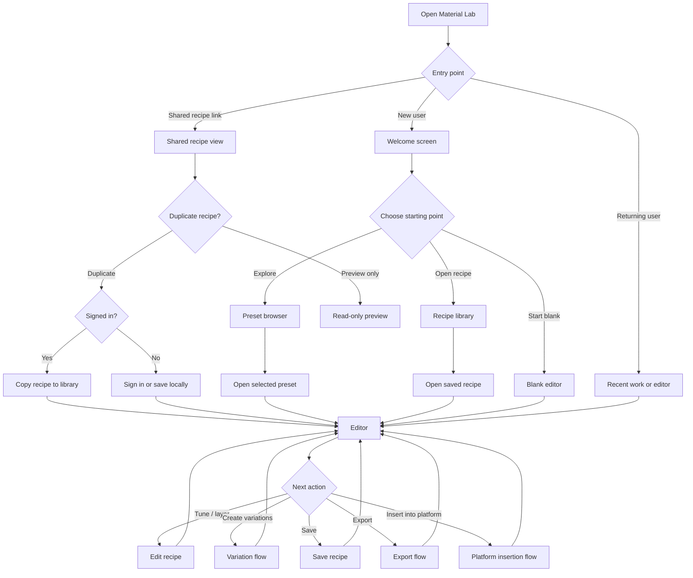

### Global behavior

- Any unsaved-change navigation must present a decision: **Save**, **Discard**, or **Cancel**.
- For signed-out users, recipe save behavior must be explicit. Local recipe saving can remain available when implemented; cloud sync must request sign-in.
- Opening a preset creates an editable recipe instance. It must not modify the canonical preset itself.
- A render failure must not discard editor state or replace the last valid preview with a blank canvas.

---

## 5. Flow A — First-time user creates and exports a texture

### User goal
Create a useful texture quickly without needing an account or understanding every advanced parameter.

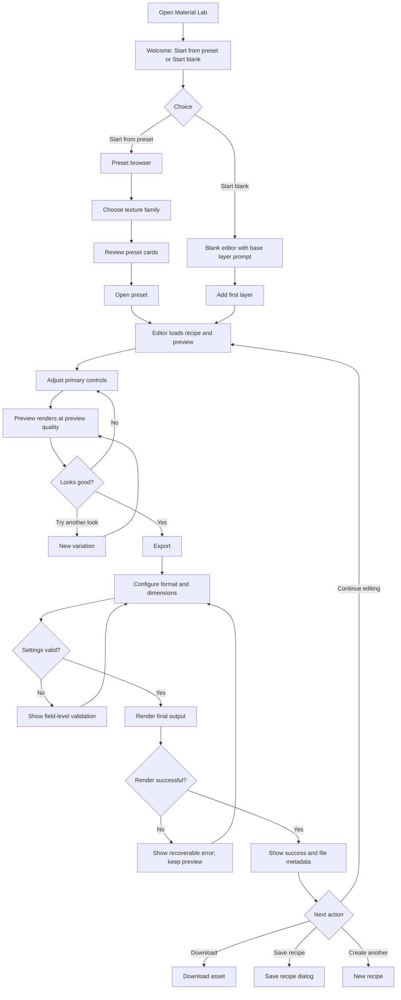

### Interaction details

1. The welcome screen has two primary actions: **Start from a preset** and **Start blank**.
2. Preset cards show a representative preview, family, name, short description, and any beta/limitation label.
3. The editor opens with a sensible default canvas and selected layer. Avoid opening a complex settings modal before the first preview.
4. Basic controls appear for the selected texture family; advanced controls are collapsed.
5. The export dialog defaults to a sensible format and dimensions based on the intended use case. PNG is selected when transparency is enabled; JPEG cannot preserve alpha.
6. A successful export shows format, dimensions, file size, seed, and recipe/engine metadata where available.
7. The success state should encourage **Save recipe** so the texture can be recreated, but must not block a local download behind account creation.

### Empty and error states

- **No preset selected:** keep the preset browser usable; do not show an empty editor as if it were broken.
- **Preview initializing:** show a lightweight skeleton or loading indicator, then reveal the first valid result.
- **Render error:** explain likely next steps (reduce complexity, lower preview resolution, or retry).
- **Export too large:** recommend a smaller size or scale instead of silently lowering resolution.
- **Browser cannot download:** provide a retry action and, if feasible, a browser-specific instruction.

### Completion criteria

- User can create a first texture and download it without signing in.
- User sees a valid result before being asked to tune advanced parameters.
- First successful export includes enough information to reproduce the result.

---

## 6. Flow B — Browse, search, and open a preset

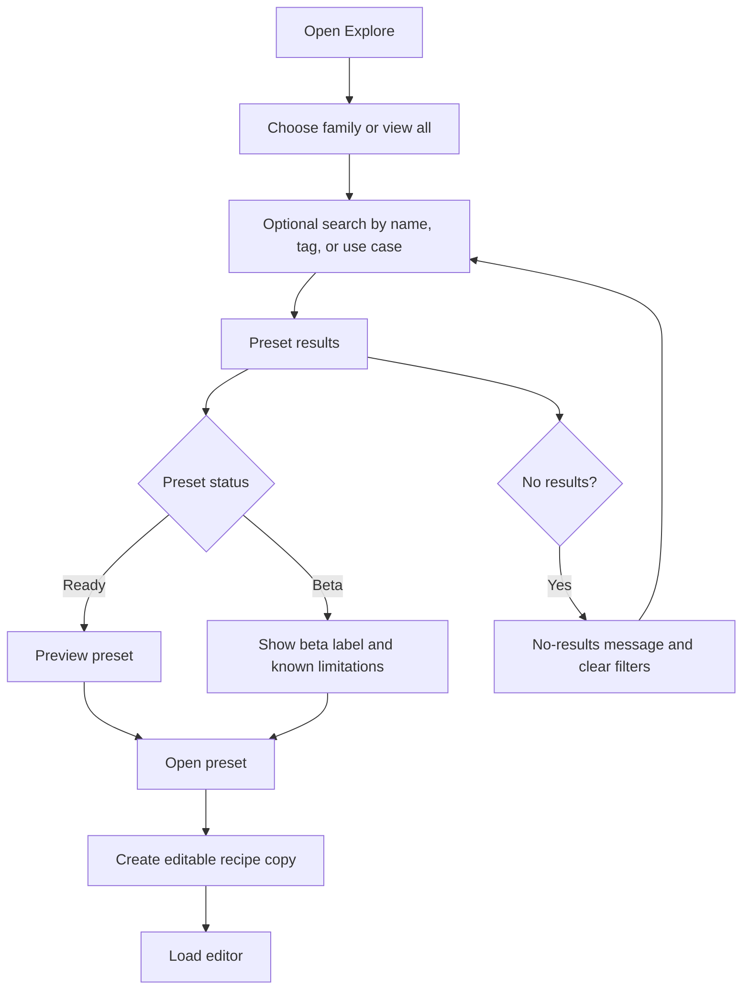

### Requirements

- Categories: Glass, Grain, Paper, Metallic, Fabric, Noise, Liquid.
- Search should include preset name, family, tags, and use case.
- A preset preview can be shown before full editor initialization, but opening it must load the editable recipe parameters.
- Beta or partially supported presets must be clearly labeled and must not be presented as fully production-ready.
- If search has no results, preserve the query and provide a simple clear/reset action.

---

## 7. Flow C — Build and manage a layered texture

### User goal
Combine layers such as paper + grain or glass + noise while maintaining predictable order and control.

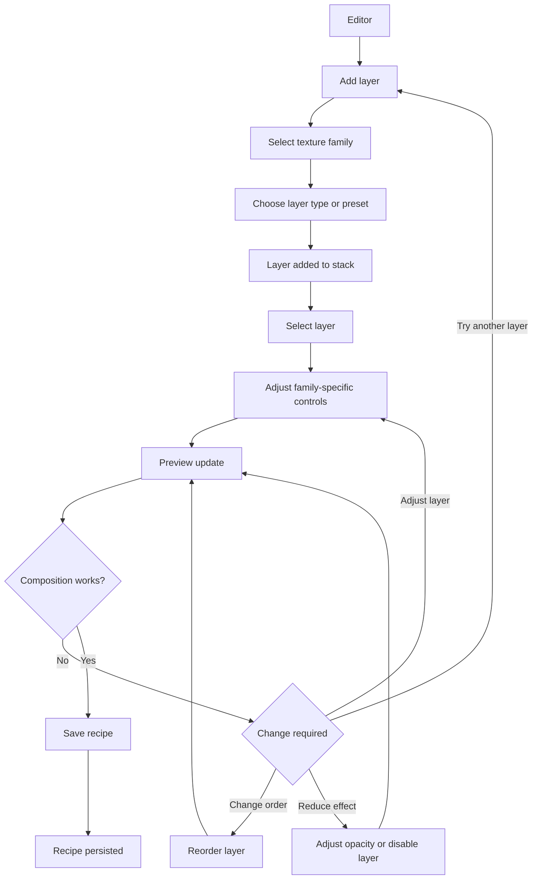

### Layer operations

- Add a layer from supported texture types.
- Select a layer to edit its relevant controls.
- Rename and duplicate layers.
- Drag to reorder layers, with keyboard-accessible move-up/move-down actions.
- Toggle visibility without deleting a layer.
- Change opacity where supported by the rendering model.
- Remove a layer with confirmation only when the action would remove meaningful work or when recovery is not available.
- Undo and redo supported layer and parameter changes.

### Layer-state rules

- The selected layer is visually distinct and its controls are shown in the properties panel.
- Disabled layers remain in the recipe but do not contribute to the render.
- Reordering should update the preview while retaining each layer's parameters.
- If a layer type is incompatible with an operation, show the restriction inline; do not silently ignore its settings.
- A layer-count or performance limit must be communicated before the user exceeds it.
- If the last layer is removed, show a purposeful blank-state CTA to add a new layer.

### Destructive action flow

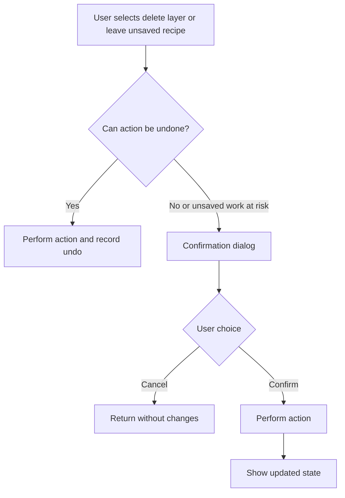

---

## 8. Flow D — Adjust texture parameters and preview

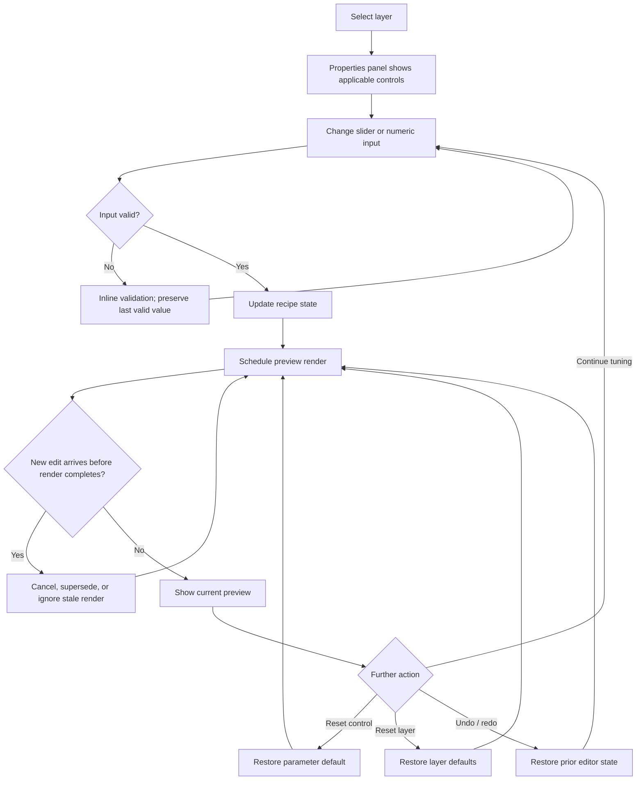

### Preview requirements

- Keep the most recent valid preview visible while a new render is processing.
- Debounce rapid slider changes as appropriate; numeric field changes can render on commit or controlled input cadence.
- Stale async renders must not replace a newer result.
- Use preview-resolution mode when full-resolution rendering would harm responsiveness.
- Distinguish **Preview quality** from **Export quality** in the UI.
- Show progress for operations that exceed the agreed short-operation threshold.
- When rendering fails, offer retry and an appropriate simplification path while preserving current parameter changes.

### Parameter control behavior

- Each parameter has a name, units where applicable, min/max, default, current value, and accessible label.
- Numeric fields reject or correct invalid values and explain the valid range.
- A control reset resets only that property; **Reset layer** restores all parameters for that layer.
- Color controls must support a readable color name/HEX representation where color input is available.
- Advanced controls should be collapsed by default and must not be required to create a good result.

---

## 9. Flow E — Create deterministic variations

### User goal
Explore alternatives while retaining intentional control over what can change.

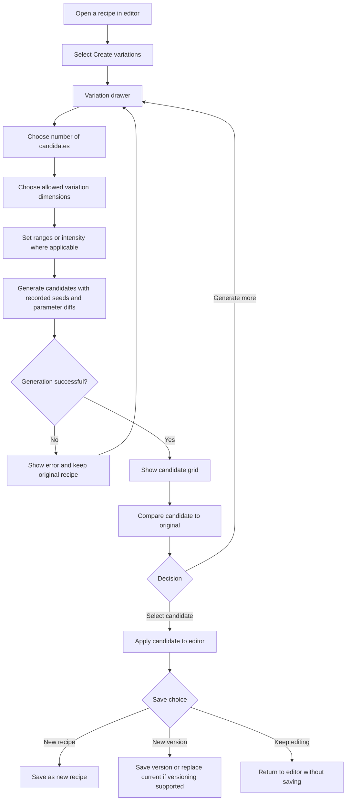

### Variation configuration

Users should be able to choose which properties may change, such as:

- Seed only.
- Palette or tint.
- Grain amount / scale.
- Layer intensity or opacity.
- Selected family-specific parameters.

Only supported parameters should appear for the current recipe. A variation must not silently alter unrelated properties.

### Variation card contents

- Preview thumbnail.
- Variation identifier / seed.
- Short description of changed parameters.
- **Compare** action.
- **Use this variation** action.
- Optional favorite action, if supported.

### Error and performance behavior

- Limit candidate count to a supported set, such as 4, 8, or 12, depending on device/performance constraints.
- If only some candidates render, show successful candidates and a clear partial-failure notice; do not discard them all.
- The original recipe must remain available until the selected candidate is explicitly applied.
- Batch export is a later capability; if unavailable, export candidates individually.

---

## 10. Flow F — Save, rename, duplicate, favorite, and delete recipes

### Save current recipe

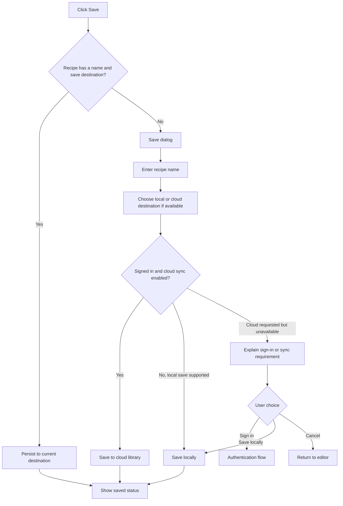

### Recipe library operations

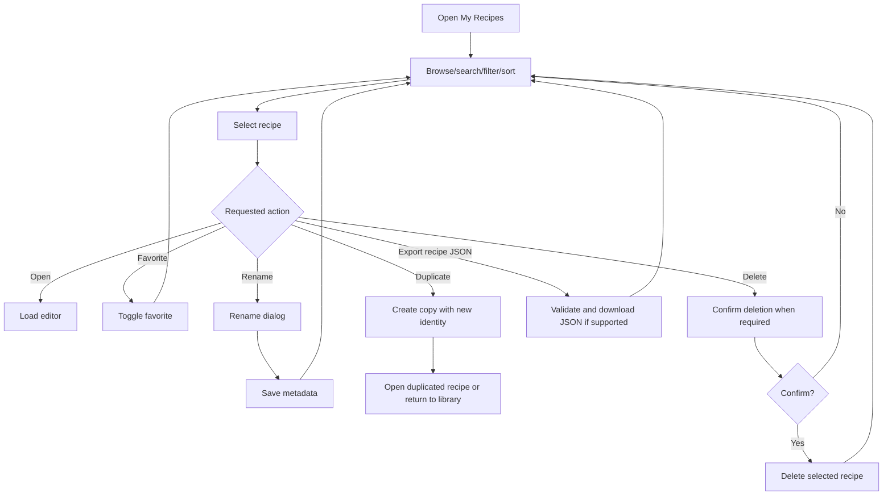

### Save conflict and failure handling

- If a recipe with the same name exists, allow **Replace**, **Save as copy**, or **Cancel**; do not overwrite without clear intent.
- Recipe names should be trimmed and length-limited; reject empty names.
- If cloud save fails, preserve the unsynced version and offer retry or local save.
- If sync has a conflict, explain the competing versions and provide a safe choice. Never silently discard the newest user edits.
- When deleting a shared or team recipe, explain the scope of deletion and check permissions before applying it.

---

## 11. Flow G — Export a texture from the web app

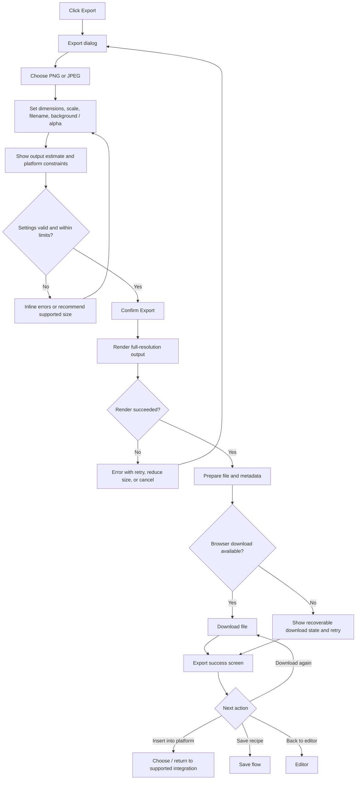

### Export form requirements

- **Format:** PNG or JPEG in MVP.
- **Dimensions:** presets plus custom width/height within product and platform limits.
- **Scale:** supported output scale factor where relevant.
- **Transparency:** available for PNG only when the selected composition supports alpha; hide or disable incompatible options with an explanation.
- **Background:** transparent or explicit color where supported.
- **Filename:** generated from recipe name and dimensions, editable by the user.
- **Validation:** catch nonpositive dimensions, dimensions beyond limits, unsupported combinations, and likely memory-heavy requests before rendering.
- **Estimate:** where feasible, show approximate file size or a clear note that actual size depends on texture complexity and format.

### Export success metadata

Show:

- Filename and format.
- Actual pixel dimensions.
- File size.
- Recipe name and seed where available.
- Engine version or recipe reference when available.
- Actions: download again, save recipe, continue editing, insert into supported platform.

### Export failure handling

- Keep the editor state unchanged.
- Use plain-language reasons and next actions.
- Offer **Retry**, **Reduce dimensions**, **Change format**, and **Cancel** where relevant.
- Do not silently convert PNG to JPEG or discard transparency.
- If a requested size exceeds an integration's platform limit, identify the limit and suggest an allowed size.

---

## 12. Flow H — Insert a texture into Figma

**Platform caveat:** The first supported workflow inserts a rendered raster image into the current Figma file. Recipe parameters remain editable in Material Lab; the inserted raster does not make all shader controls natively editable inside Figma.

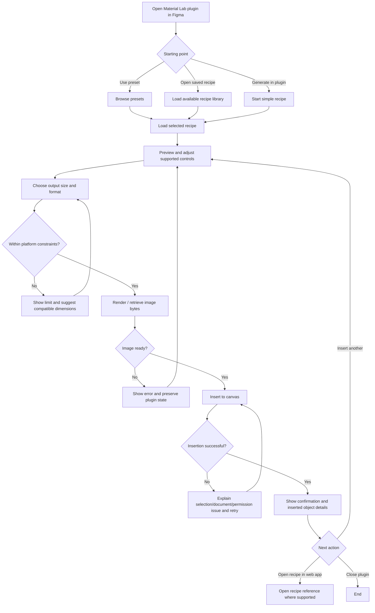

### Figma-specific behavior

- Provide **Use preset**, **Open saved recipe**, and **Generate in plugin** entry paths appropriate to implementation scope.
- Respect the current document and selection context; do not unexpectedly replace selected objects.
- Ask how to insert only if there is a meaningful choice (for example, fill selected shape vs create new shape/frame).
- If selection is empty, default to creating a new image-backed shape/frame and explain what will be inserted.
- If selection is incompatible, offer **Insert as new object** or **Cancel**.
- Label the result as a rendered image-backed object.
- If recipe metadata or a reopen link is attached to the inserted object, describe it as a reference to the editable recipe—not native texture-layer editability.
- Enforce supported dimension/format limits and handle API errors.

### Figma insertion decision flow

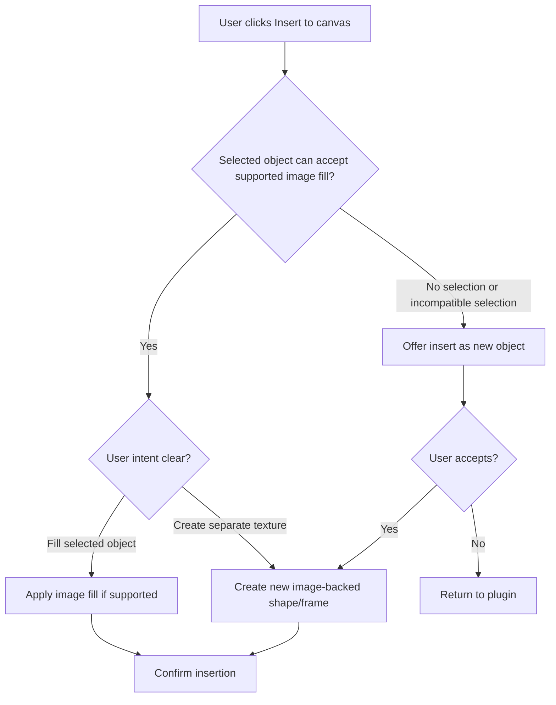

---

## 13. Flow I — Add a texture from the Canva app

**Platform caveat:** Canva integration must use the officially supported app SDK and asset-insertion workflow available to the implementation. Do not assume every layer setting can become a native editable Canva effect.

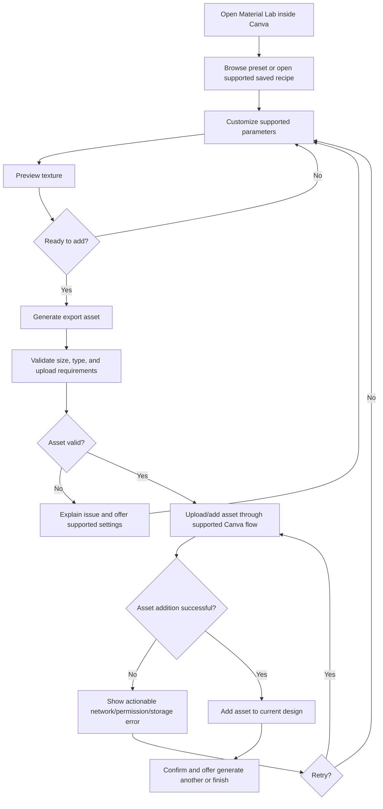

### Canva-specific behavior

- Show platform-approved authentication and permission prompts only when required.
- Generate or upload an output type that Canva supports in the selected workflow.
- Make upload/add-to-design actions explicit; do not imply the asset is added before the SDK confirms success.
- Handle unavailable network, unsupported format, asset limits, and permission denial.
- If the app cannot update the current design context, explain how to access the uploaded asset through the available Canva UI.

---

## 14. Flow J — Use Material Lab with Framer

**Platform caveat:** Begin with the integration path proven by a technical spike. A raster asset flow is the fallback; native/code-oriented texture effects are an enhancement only if the supported Framer API and deployment behavior allow it.

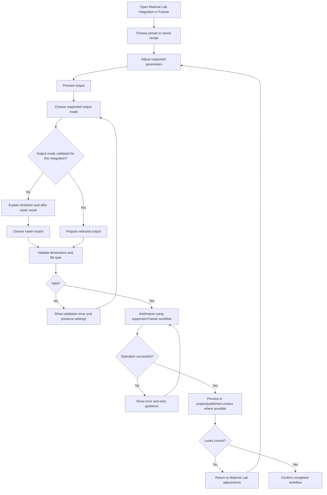

### Framer-specific behavior

- Clearly distinguish a generated image asset from a native Framer effect or code component.
- Check the project's supported import/insertion flow before displaying an action.
- Let users verify the result in a relevant preview context; never claim production rendering was checked if only an editor preview was available.
- Preserve recipe reference and export metadata when possible.

---

## 15. Flow K — Save and reuse a recipe across platforms

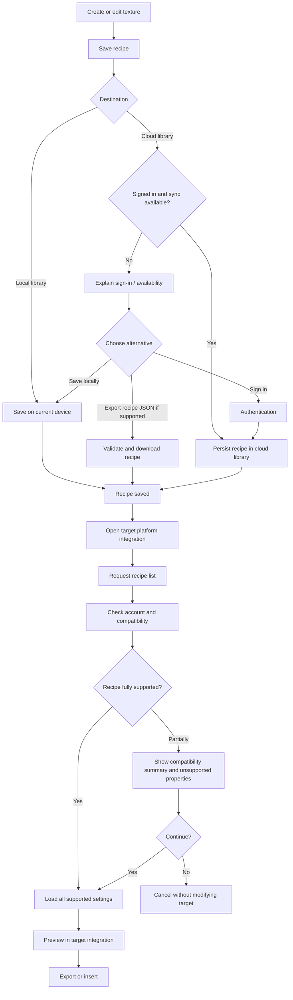

### Compatibility rules

- Use a versioned recipe schema.
- Each integration declares supported texture families, parameter ranges, blend behaviors, and output formats.
- If an unsupported property is encountered, preserve the original recipe and indicate the property that cannot be represented.
- Do not silently flatten a recipe when the user expects editable parameters; explain that raster rendering will flatten the visual result.
- Cross-platform parity may be approximate because renderers and platform image handling differ. Where relevant, display a compatibility note and preview the target output.

---

## 16. Flow L — Optional sign-in and cloud sync

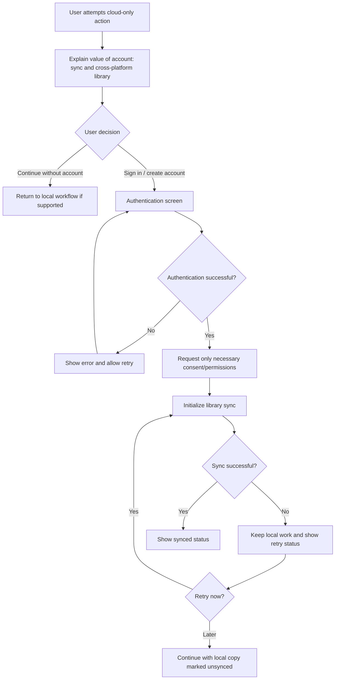

### Sync requirements

- Do not require sign-in for basic generation or local export.
- Tell the user which feature requires an account before opening authentication.
- Never lose a local recipe because authentication or sync fails.
- Display sync state clearly: **Saved locally**, **Syncing**, **Synced**, or **Sync failed**.
- If cross-device sync is not yet available, do not show it as an active benefit; use a truthful roadmap label instead.

---

## 17. Flow M — Open a shared recipe link

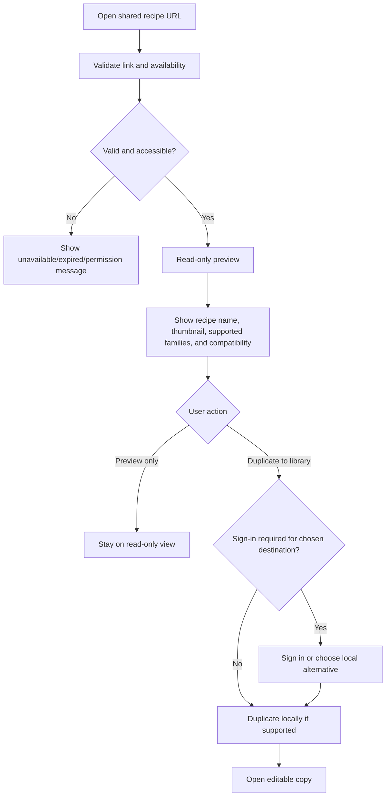

### Sharing rules

- Shared links are read-only unless the user duplicates the recipe.
- Do not expose private recipe details in public links without explicit sharing action.
- A deleted, revoked, expired, or permission-restricted link must fail safely.
- A duplicated recipe receives a new identity and does not mutate the original shared recipe.

---

## 18. Flow N — Choose controls for each texture family

This flow standardizes how family-specific panels behave without requiring identical controls across all materials.

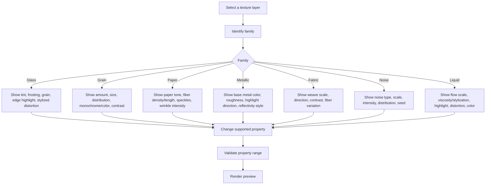

### Family-panel UX requirements

- Show only controls relevant to the selected family and current layer.
- Use designer-friendly labels with tooltips or concise helper text for technical terms.
- Keep essential controls visible; put specialist settings in an **Advanced** section.
- Every random or stochastic effect must have a seed in the recipe data model.
- If a visual property is background-dependent, explain that the export may look different over another background.
- Presets should be built from the same recipe schema and controls as user-created textures, unless a documented exception is necessary.

---

## 19. Flow O — Import/export recipe JSON (P1)

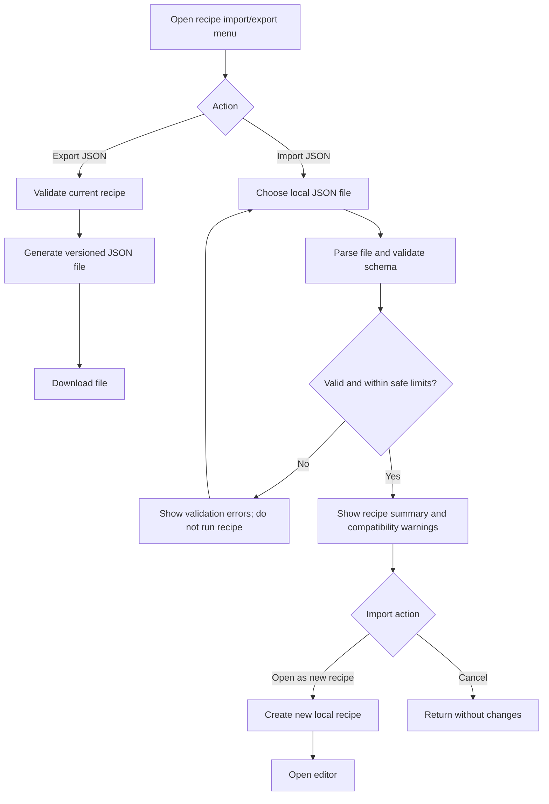

### Import safety requirements

- Validate schema version, parameter ranges, layer count, file size, texture family IDs, and references.
- Do not execute arbitrary code or scripts contained in an imported file.
- Never override an existing recipe without explicit confirmation.
- If the schema is older and migratable, migrate it and record the new schema version; if not, explain the incompatibility.
- If some layers are unsupported by the current build, offer a clear choice to cancel or import a compatible subset only when that partial behavior is explicitly described.

---

## 20. Flow P — Recover from common errors

### Render failure

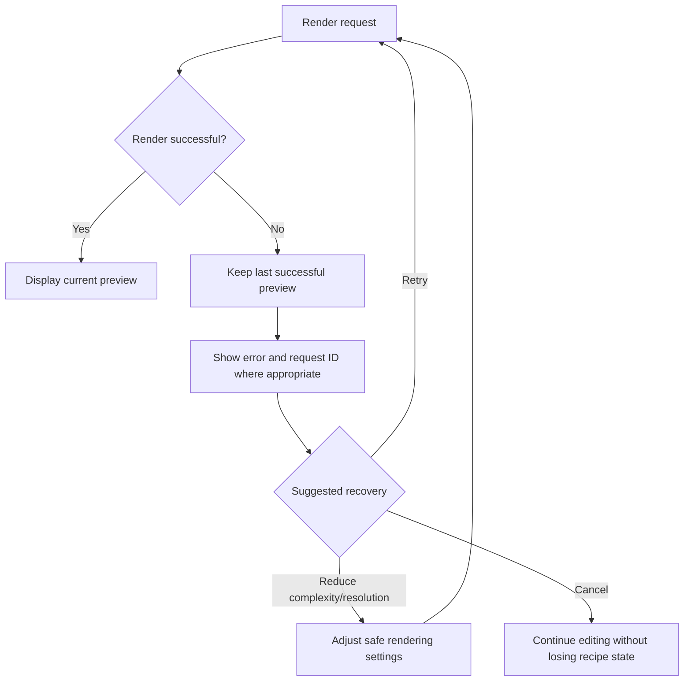

### Export failure

```mermaid
flowchart TD
    A[Export request] --> B[Validate settings and render]
    B --> C{Failure type}
    C -->|Invalid dimensions| D[Highlight dimension fields]
    C -->|Memory/performance| E[Recommend smaller size or simpler composition]
    C -->|Unsupported format/alpha| F[Explain supported alternatives]
    C -->|Download/network issue| G[Offer retry or alternate supported delivery]
    D --> H[User corrects settings]
    E --> H
    F --> H
    G --> I{Retry?}
    I -->|Yes| B
    I -->|No| J[Return to editor with all work preserved]
    H --> B
```

### Save or sync failure

- Mark the recipe as unsynced rather than falsely showing **Saved**.
- Keep a recoverable local copy where supported.
- Provide **Retry**, **Save locally**, and **Cancel** where relevant.
- If the server rejects a recipe due to schema/plan restrictions, explain what specifically is unsupported.

---

## 21. Flow Q — Settings and export defaults

```mermaid
flowchart TD
    A[Open Settings] --> B[Choose Export defaults]
    B --> C[Set default format, dimensions, scale, transparency preference]
    C --> D[Validate combination]
    D --> E{Valid?}
    E -->|No| F[Explain invalid combination]
    F --> C
    E -->|Yes| G[Save preferences]
    G --> H[Confirm saved settings]
    A --> I[Choose account, privacy, or connected platforms]
    I --> J[Update preference or inspect integration status]
```

Default settings should be suggestions, not hidden rules. The export dialog must still show the effective settings for each export and allow deliberate overrides.

---

## 22. Platform-specific entry and exit rules

### Web app

- Can create, edit, save locally, and export without platform login.
- Cloud sync and shared libraries may require Pureland authentication.
- The web app is the canonical full editor and should support all MVP layer and recipe operations.

### Figma plugin

- Start from preset, saved recipe, or simple in-plugin generation.
- Insert a rendered image object or supported image fill only after user action.
- Do not state that all parameters are editable inside Figma unless the actual implementation supports that capability.
- If a recipe link is available, it should reopen the source recipe in Material Lab.

### Canva app

- Use only the supported SDK permissions and asset flow available to the app.
- Make the add-to-design action explicit and confirm only after success.
- If asset upload succeeds but placement is not automatic, explain where the user can find the uploaded asset.

### Framer integration

- Offer only output actions validated by a technical spike.
- If the native/code effect path is unsupported or not ready, offer the raster asset path clearly.
- If a texture is represented as a static image, label it as such.

---

## 23. State model and unsaved changes

### Recipe/editor states

| State | Meaning | Expected UI |
|---|---|---|
| `empty` | No recipe/layers are loaded | Prompt to choose a preset or add a layer |
| `loading` | Recipe or preset is loading | Skeleton/progress; disable conflicting actions |
| `dirty` | Current recipe differs from last saved state | Unsaved indicator; save action enabled |
| `rendering` | A preview/export render is in progress | Keep old preview; show progress where needed |
| `render_error` | Latest render failed | Preserve last valid preview and show recovery options |
| `saved_local` | Recipe saved to this device | Local saved indicator |
| `syncing` | Cloud save/sync is in progress | Syncing indicator; keep local state |
| `synced` | Cloud version is up to date | Synced indicator |
| `sync_error` | Cloud save/sync failed | Unsynced indicator plus retry/local-save actions |
| `exporting` | Final output is being prepared | Progress and cancel where safe |
| `export_error` | Export did not finish | Actionable error, settings retained |
| `export_success` | Output is ready | File metadata and next actions |

### Navigation with unsaved changes

When a user closes the editor, switches recipe, opens another destination, or navigates away while state is `dirty`:

1. Present **Save**, **Discard changes**, and **Cancel**.
2. If saving fails, remain in the editor and preserve the draft.
3. Do not use a generic browser alert unless technical constraints leave no accessible alternative.
4. If auto-recovery/draft restore is implemented, label restored content as a draft until the user confirms save.

---

## 24. Accessibility and interaction rules

- All primary actions can be reached by keyboard.
- Layer reordering has keyboard controls in addition to drag and drop.
- Sliders expose labels and current values to assistive technology; pair them with numeric entry when precision matters.
- Focus moves predictably into dialogs and returns to the initiating control when a dialog closes.
- Errors identify the affected field and describe how to fix the issue.
- Status is not communicated by color alone; include text or icons with accessible names.
- Preview controls (zoom, fit, background/checkerboard) have names and visible focus states.
- Respect reduced-motion preferences for UI transitions; this does not necessarily alter the generated texture unless that behavior is part of the output settings.
- Maintain sufficient contrast for editor UI and labels regardless of the texture shown in the preview.

---

## 25. Analytics events aligned to flows

Analytics must not upload generated images or full recipe contents by default. Event payloads should use IDs, counts, durations, status codes, and coarse feature metadata unless the user explicitly opts into sharing more.

| Event | Trigger | Useful properties |
|---|---|---|
| `material_lab_opened` | App/plugin opened | `platform`, `entry_point` |
| `preset_browser_opened` | Explore opened | `platform` |
| `preset_selected` | Preset opened | `family_id`, `preset_id` |
| `recipe_created` | New recipe initiated | `source` (`preset` / `blank` / `import`) |
| `layer_added` | Layer added | `family_id`, `layer_count` |
| `layer_operation` | Rename, duplicate, move, toggle, delete | `operation`, `layer_count` |
| `parameter_changed` | User changes property | `family_id`, `parameter_id`, `input_type` (avoid raw sensitive values) |
| `preview_render_started` | Render requested | `render_mode`, `layer_count` |
| `preview_render_completed` | Preview rendered | `duration_ms`, `resolution_class`, `success` |
| `variation_generation_started` | Variations requested | `candidate_count`, `allowed_dimension_count` |
| `variation_selected` | Candidate applied | `family_id`, `candidate_index` |
| `recipe_saved` | Local/cloud save succeeded | `destination`, `layer_count` |
| `recipe_save_failed` | Save failed | `error_category`, `destination` |
| `export_started` | Export confirmed | `format`, `dimension_class`, `alpha_requested` |
| `export_completed` | Export succeeded | `duration_ms`, `format`, `file_size_class` |
| `export_failed` | Export failed | `error_category`, `format` |
| `platform_insert_started` | Insert/add initiated | `platform`, `output_type` |
| `platform_insert_completed` | Insert/add succeeded | `platform`, `output_type` |
| `platform_insert_failed` | Insert/add failed | `platform`, `error_category` |
| `auth_prompt_opened` | Sign-in prompt shown | `trigger_feature` |
| `sync_status_changed` | Sync status changes | `status`, `platform` |

### Funnel definitions

- **Activation:** user creates or modifies a recipe and completes an export or platform insertion during an initial session.
- **Recipe adoption:** user saves a recipe and later reopens or duplicates it.
- **Platform activation:** user successfully inserts/adds a generated asset into a platform.
- **Export reliability:** successful exports divided by export attempts, segmented by format and dimension class.
- **Repeat usage:** user returns to create, edit, or export a recipe in a later time window.

---

## 26. QA scenarios and acceptance checklist

### First-time creation
- [ ] User can start from a preset or blank recipe.
- [ ] All shipped families have clearly labeled presets and supported controls.
- [ ] User can make a texture without signing in.
- [ ] First preview appears without requiring a full page reload.

### Layers and editing
- [ ] User can add, rename, duplicate, reorder, hide/show, adjust opacity, and remove layers.
- [ ] Reorder and visibility changes appear in the next current preview.
- [ ] Undo/redo restores supported recipe state accurately.
- [ ] Deleting or leaving unsaved work follows the intended confirmation behavior.

### Deterministic output and variations
- [ ] Same recipe, seed, engine version, and output settings reproduce results within the declared tolerance.
- [ ] New variation changes only selected or documented parameters.
- [ ] Candidate metadata includes enough information to recreate a selected variation.
- [ ] Original recipe remains recoverable while comparing variations.

### Recipe management
- [ ] Save, rename, duplicate, favorite, reopen, and delete work as specified.
- [ ] Name conflicts never overwrite without clear user intent.
- [ ] A save/sync failure preserves work and exposes retry/recovery actions.
- [ ] Imported recipes are schema-validated before use.

### Export
- [ ] PNG/JPEG settings are correctly validated.
- [ ] Transparency is preserved only when requested and supported.
- [ ] Output dimensions and format match the selected settings.
- [ ] Large exports give a useful warning/recommendation rather than failing silently.
- [ ] Success metadata is accurate; failure states retain the user's work.

### Integrations
- [ ] Figma insertion is verified in a real plugin prototype and identifies the result as image-backed when applicable.
- [ ] Incompatible Figma selection offers a safe alternative without replacing objects unexpectedly.
- [ ] Canva confirms asset addition only after the supported SDK reports success.
- [ ] Framer exposes only validated output/insertion behavior and provides raster fallback where appropriate.
- [ ] Every integration handles permission denial, unsupported configuration, and transient failure.

### Accessibility and analytics
- [ ] Primary actions work with keyboard navigation.
- [ ] Dialog focus behavior is correct.
- [ ] Error messages identify the problem and next step.
- [ ] Analytics do not send the image or full recipe payload by default.

---

## 27. Recommended MVP implementation sequence

1. **Preset-to-editor flow:** ship a small number of high-quality presets across the seven planned families; label beta families honestly if quality gates are not met.
2. **Core editing:** layer stack, family-specific controls, preview rendering, deterministic seeds, undo/redo.
3. **Local recipe management:** save, rename, duplicate, reopen, favorite, delete.
4. **Reliable export:** PNG/JPEG, alpha behavior, dimensions, validation, progress, recovery.
5. **Telemetry and QA:** activate, render, save, export, and failure funnels.
6. **Figma proof of concept:** validate image creation/insertion constraints and recipe-reopen linkage.
7. **Account/sync:** add only after local-first workflows are reliable and a cross-platform need is validated.
8. **Canva and Framer prototypes:** verify APIs, review requirements, asset insertion, and actual user experience before publicly promising parity.

---

## 28. Open decisions

Resolve these with product/engineering before committing delivery dates:

1. Is the first release local-first with optional cloud sync, or does it require an account to save recipes?
2. Which family-specific effects make the initial quality bar, and which should ship as beta?
3. What maximum canvas dimensions and layer count can be rendered reliably on reference hardware?
4. How should a selected Figma shape behave by default: fill selection or create a new image-backed object?
5. Which recipe properties can each platform integration faithfully support?
6. Does the first release need seamless tiling, or can it move to the next milestone?
7. What is the exact recovery behavior for drafts if the browser or plugin closes unexpectedly?
8. Which recipe metadata can safely be attached to platform-created objects without violating platform restrictions?
9. Which analytics properties are necessary for product decisions without capturing private design content?

---

## 29. Source-of-truth notes

- This user-flow document expands the workflows described in `Material_Lab_Texture_Generator_PRD.md`.
- The PRD owns product goals, scope, functional requirements, data model, technical architecture, and success metrics.
- Platform-specific insertion details are subject to technical validation and the APIs available at implementation time.
- Any discrepancy should be resolved against the current PRD and a tested platform prototype before development ships.
